# Locally Operated AIoT Facility Intelligence Platform

**Design and Development of a Lightweight, Locally Operated AIoT Platform for Integrated Smart Facility Management and Vision-Based Presence Verification.**

[](https://github.com/aliloay/smart-lab-portal/actions/workflows/ci.yml)


A modular, lightweight, locally operated AIoT platform that integrates access control, vision-based presence monitoring, environmental sensing, resource management, AI agents, digital-twin visualisation and workflow automation for intelligent facility management. It runs on one local network without needing the internet for its core operations.

The **Smart Research Laboratory at the German International University (GIU), Cairo** is the development and demonstration environment. Universities, hospitals, banks, industrial and corporate facilities are potential application environments, not deployments.

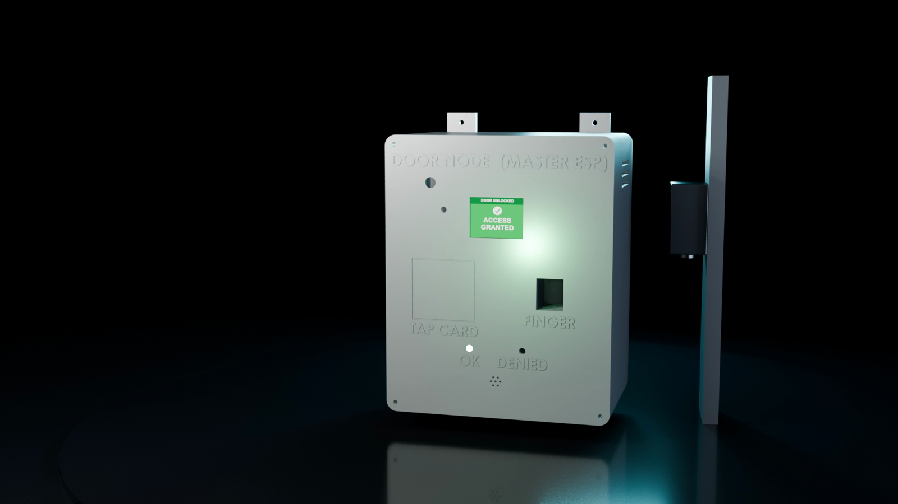

---

## Contents

[Problem](#the-problem) · [Solution](#the-solution) · [Differentiators](#differentiators) · [Architecture](#system-architecture) · [Hardware](#physical-hardware-four-nodes) · [Access and vision](#access-and-vision-presence-verification) · [Environment](#environment-monitoring) · [Resources](#consumables-and-reusable-equipment) · [AI](#ai-assistants) · [Obsidian](#obsidian-knowledge-base) · [n8n](#n8n-workflow-automation) · [Digital twin](#digital-twin) · [AR](#mobile-augmented-reality) · [PCs](#computer-and-infrastructure-monitoring) · [Portal](#unified-portal) · [Local-first](#local-first-operation) · [Requirements](#requirements) · [Install and launch](#installation-and-one-command-launch) · [Configuration](#configuration) · [Firmware](#firmware) · [Testing](#testing-and-validation) · [Security](#security-and-privacy) · [Limitations](#known-limitations) · [Structure](#project-structure) · [Academic context](#academic-context) · [Licence](#licence-and-attribution)

## The problem

Facilities run access control, cameras, occupancy, environmental sensors, consumables, shared equipment, computers and reporting as separate systems. A door log says who badged in, not who is inside an hour later; a camera sees people but not who was allowed in; stock moves without anyone linking it to who was present. Staff stitch the picture together by hand, often in cloud tools that send building data off site.

## The solution

One local backend that every device, camera, robot collector and PC agent reports to, one portal on top of it, and rules that connect the records: a door entry becomes a presence record the cameras can confirm; a stock withdrawal while nobody is inside becomes something to check; a sensor threshold becomes an alert and a workflow. Local language models answer questions from the records and from the project's knowledge base.

## Differentiators

| | What it means here |
|---|---|
| Integration, not dashboards | Rules join door, camera, stock, sensor, robot and PC records ([INTEGRATION_MATRIX.md](INTEGRATION_MATRIX.md)) |
| Vision-based presence verification | Door sessions cross-checked with YOLO26s person tracks; "person with no door entry" and "more people seen than entered" alerts |
| Local-first | Core runs on the LAN; AI is local by default (`AI_LOCAL_ONLY=true`) |
| Modular hardware | Four ESP32 nodes in printed enclosures, each with its own firmware and API |
| Knowledge-assisted AI | An agent answers from the Obsidian vault and the code, with sources |
| Workflow automation | 23 n8n workflows; the backend decides, n8n schedules and notifies |
| Read-only digital twin | UR5e mirrored from its own telemetry; no motion commands exist |
| Phone AR | Point a phone at equipment and see its live record |
| Lightweight | One PC with a 4 GB GPU, ESP32 boards, an IP camera and a home-grade router |

Status of every capability: [SYSTEM_FEATURE_MATRIX.md](SYSTEM_FEATURE_MATRIX.md).

## System architecture

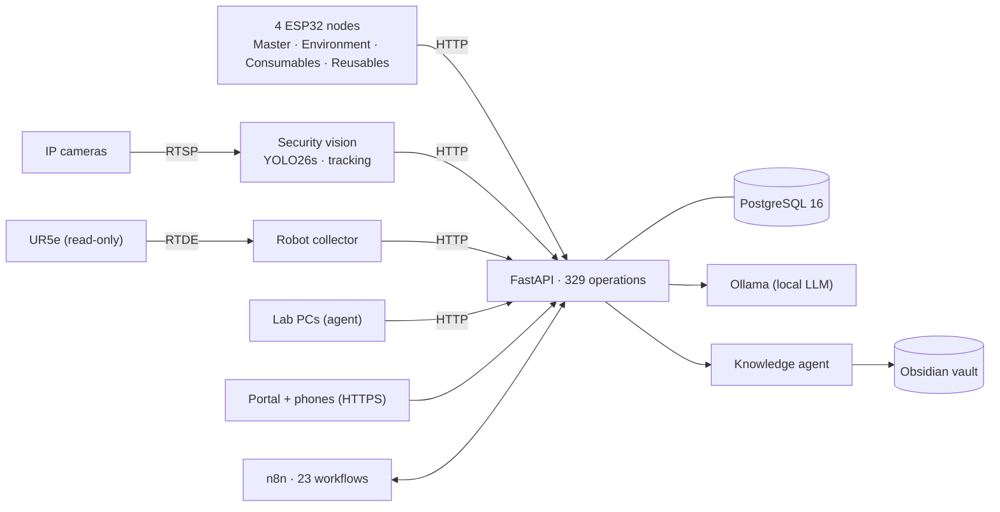

Full diagrams with protocols and sequence of an entry: [docs/architecture/master-system-architecture.md](docs/architecture/master-system-architecture.md). Decisions: [ARCHITECTURE_DECISIONS.md](ARCHITECTURE_DECISIONS.md).

## Physical hardware: four nodes

| Node | Function | Main parts | Docs |
|---|---|---|---|
| **Master** | Two-factor door access, fail-secure 12 V lock | ESP32, PN532 NFC, AS608 fingerprint, ST7735 TFT, relay, door contact, LEDs | [master-node.md](docs/hardware/master-node.md) |
| **Environment** | Monitoring only (not a certified safety device) | DHT22, MQ-2, 2× PIR, 5-channel flame board | [environment-node.md](docs/hardware/environment-node.md) |
| **Consumables** | Weighs a parts bin, estimates the count | 1 kg load cell + HX711, 16×2 LCD | [consumables-node.md](docs/hardware/consumables-node.md) |
| **Reusables** | NFC check-out, servo lid | PN532, MG90S servo, reed switch, LCD | [reusables-node.md](docs/hardware/reusables-node.md) |

| 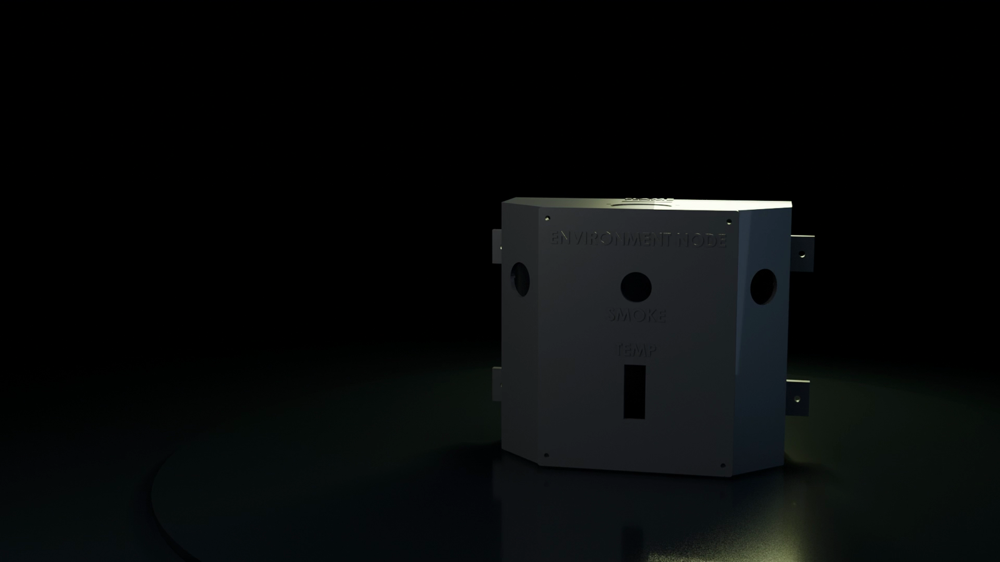 | 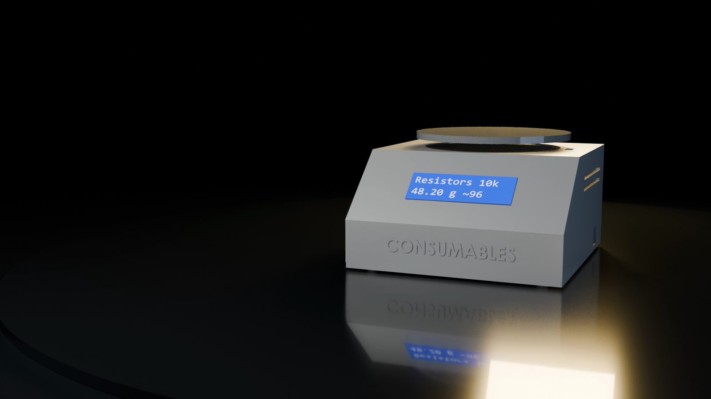 | 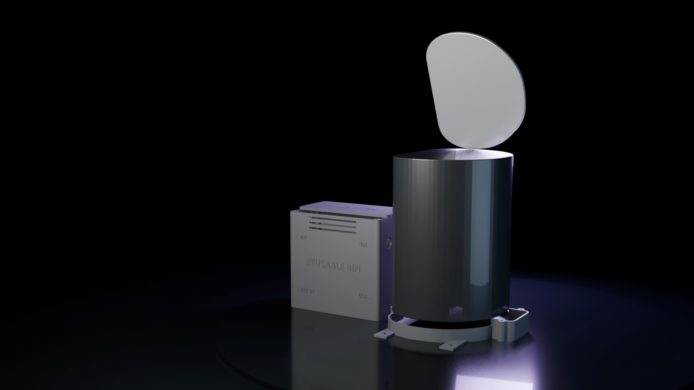 |
|---|---|---|
| Environment (render of CAD) | Consumables (render of CAD) | Reusables (render of CAD) |

Pinouts from the firmware: [wiring-and-pinouts.md](docs/hardware/wiring-and-pinouts.md) · power: [power-distribution.md](docs/hardware/power-distribution.md) · door system: [door-access-system.md](docs/hardware/door-access-system.md) · what has been measured: [hardware-validation.md](docs/hardware/hardware-validation.md) · enclosure CAD: [`tools/cad/`](tools/cad/).

## Access and vision: presence verification

1. Factor 1 (QR booking code or NFC card) and factor 2 (fingerprint or face) at the Master Node; the API opens an access session and the lock releases.
2. The security-vision service tracks people (YOLO26s) and sends tracks with identity **evidence** (own door entry, clear face match, stored look). Detection never names anyone by itself.
3. The API compares open sessions with what the cameras see and raises **Person in the lab with no door entry**, **More people seen than entered** or **Face does not match the door entry**; PC zones turn "in use" when someone sits there.

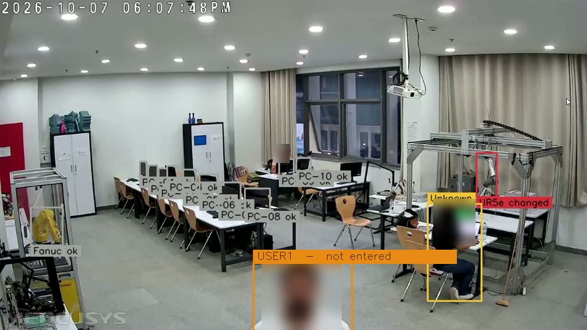

Details: [vision-system.md](docs/computer-vision/vision-system.md) · [tracking-and-presence.md](docs/computer-vision/tracking-and-presence.md) · [access-camera-integration.md](docs/computer-vision/access-camera-integration.md) · [limitations-and-validation.md](docs/computer-vision/limitations-and-validation.md).

## Environment monitoring

Temperature and humidity every 2.5 s, motion in two zones, smoke/gas by rise above baseline, and flame with direction; each sensor switched on at run time; readings and events go to the API, which raises alerts ("Smoke/gas detected at {lab}", "Motion detected in {lab}") and triggers workflows 08 and 13. Bench-verified on 5 Oct 2026. [environment-node.md](docs/hardware/environment-node.md)

## Consumables and reusable equipment

Consumables: mass → estimated pieces; low stock → reorder workflow; a withdrawal with nobody inside → a record to check (workflow 16). Reusables: an NFC tap opens the lid and logs the check-out; overdue items raise workflow 17. [consumables-node.md](docs/hardware/consumables-node.md) · [reusables-node.md](docs/hardware/reusables-node.md)

## AI assistants

Ask the lab (staff), a student assistant, Ask the project (knowledge agent), Scan the lab and local voice. Common questions are answered instantly from the records; open ones by a local model (Ollama, qwen2.5) with nine read-only tools. Assistants cannot act on hardware; the only change they prepare is a booking the user confirms. [docs/ai/](docs/ai/assistant-overview.md)

## Obsidian knowledge base

The vault ([`docs/knowledge/obsidian/vault/`](docs/knowledge/obsidian/vault/), 322 notes) is generated from this repository by `tools/knowledge/kb.py` and searched (BM25 + embeddings) by the knowledge agent, which answers with numbered sources.

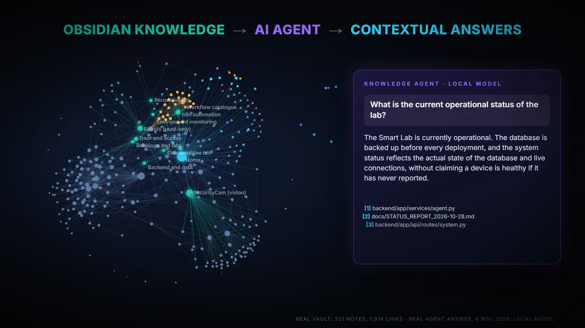

[obsidian-overview.md](docs/knowledge/obsidian-overview.md) · [ai-context-integration.md](docs/knowledge/ai-context-integration.md)

## n8n workflow automation

23 workflows (exports in [`automation/n8n/json/`](automation/n8n/json/)): reports, booking reminders, device offline, sensor thresholds, hazard escalation, low stock, unattended stock change, overdue items, robot without booking, PC offline, emergency. [n8n-overview.md](docs/automation/n8n-overview.md) · [workflow-inventory.md](docs/automation/workflow-inventory.md) · [workflow-deployment.md](docs/automation/workflow-deployment.md)

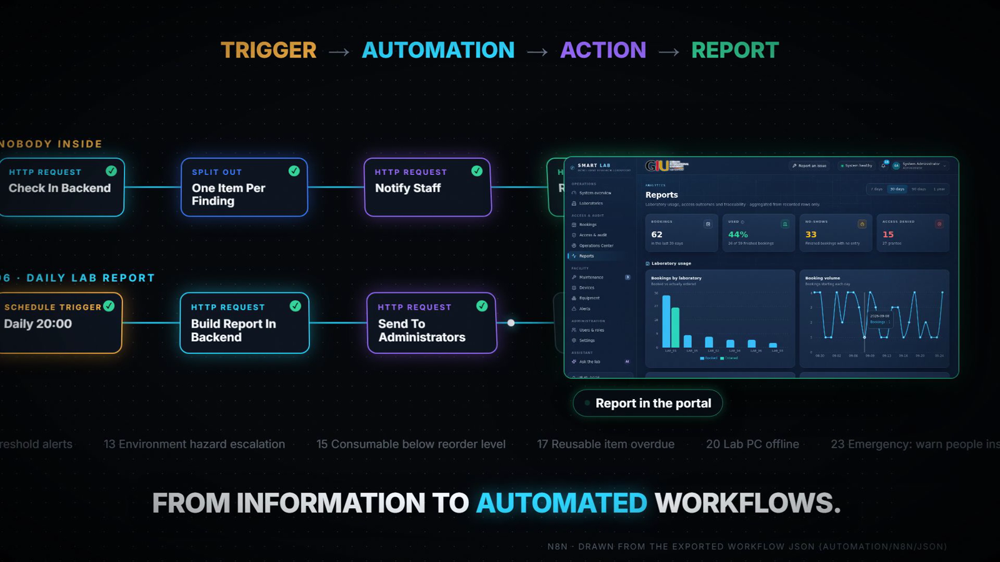

## Digital twin

The UR5e is read with `ur_rtde`'s receive interface at 50 Hz; the latest state reaches the portal every 0.2 s and drives a three.js twin with joint limits, modes, motion events and staleness. FANUC support is software-ready but not verified on hardware. No motion control is available.

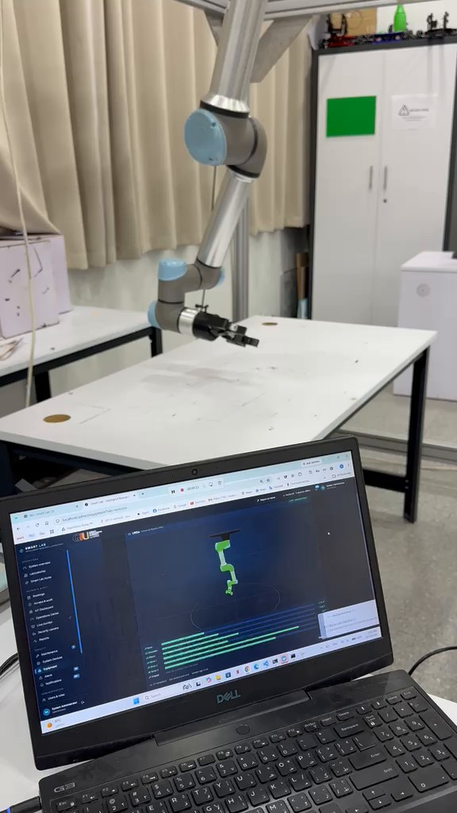

[docs/digital-twin/](docs/digital-twin/overview.md)

## Mobile augmented reality

"Scan the lab" decodes printed QR markers on the phone and pins that equipment's live record next to it; people boxes come from the camera service. It needs HTTPS (a secure context) with the local CA trusted on the phone. Measured only in a headless phone-size test so far. [docs/augmented-reality/](docs/augmented-reality/overview.md)

## Computer and infrastructure monitoring

A PC agent on each lab PC reports presence and screens; the portal shows a wall of all lab PC screens, can share the admin's screen to every PC ("Share my screen with the students") and supports an exam mode. Device health, heartbeats and backups appear on the system pages. [`tools/pc_agent/`](tools/pc_agent/) · [SMART_LAB_PC_DEPLOYMENT_GUIDE.md](docs/SMART_LAB_PC_DEPLOYMENT_GUIDE.md)

## Unified portal

| 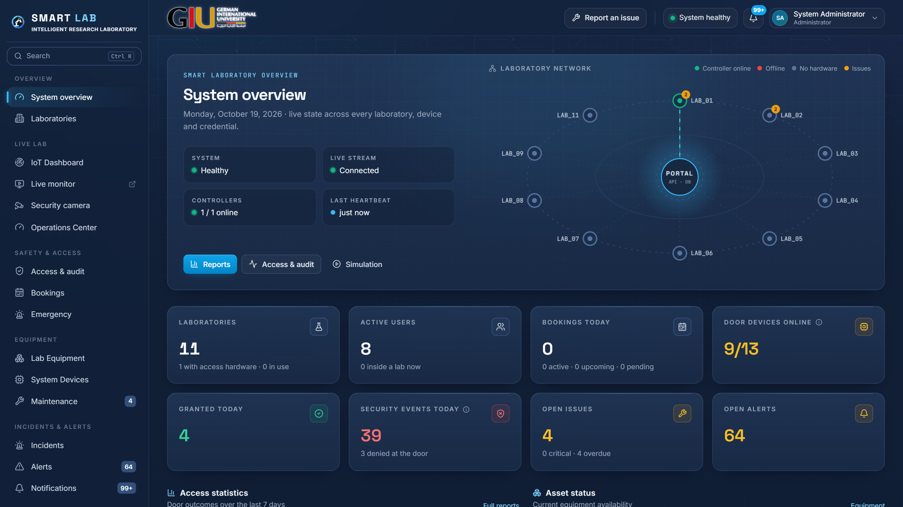 | 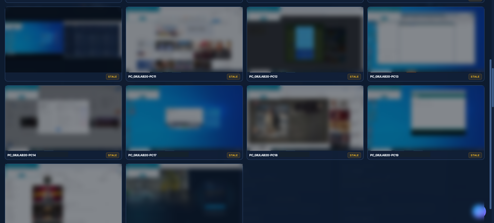 |
|---|---|
| Operations overview | All lab PC screens (names masked) |
| 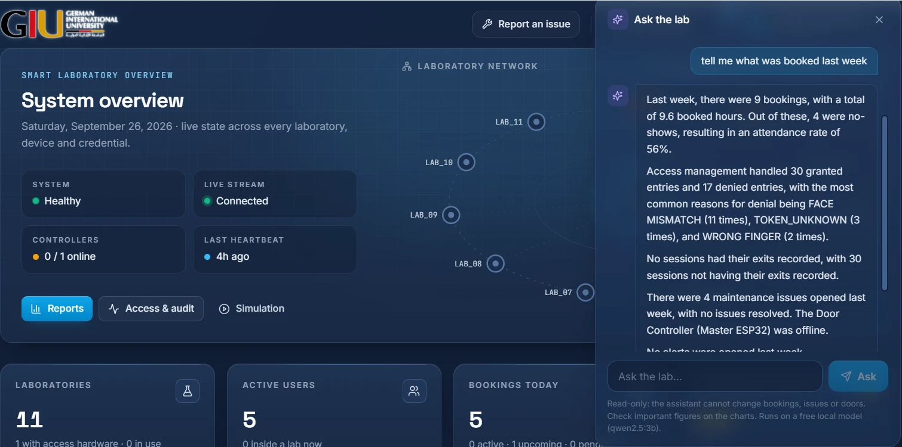 | 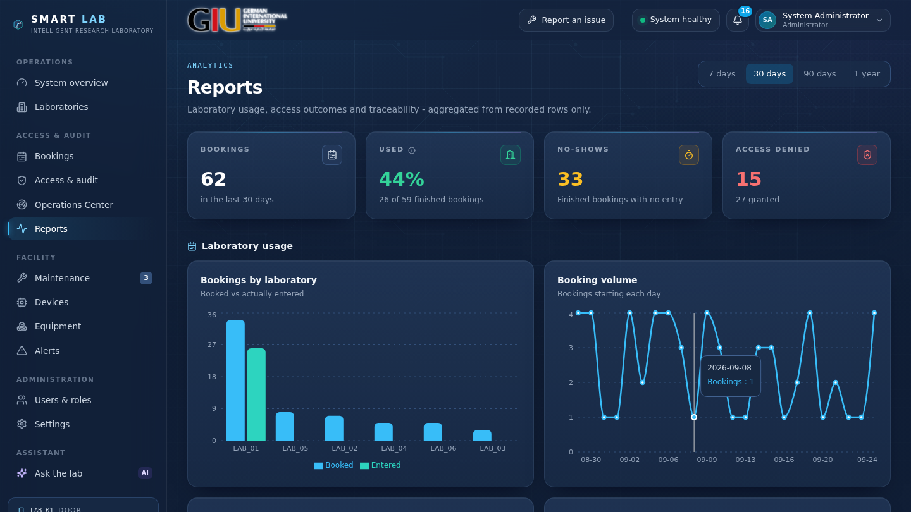 |
| AI answer from the records | Reports |

Full page-by-page guide: [docs/PORTAL_GUIDE.md](docs/PORTAL_GUIDE.md) · frontend: [docs/software/frontend.md](docs/software/frontend.md) · backend: [docs/software/backend.md](docs/software/backend.md) · API: [docs/software/api-reference.md](docs/software/api-reference.md) · database: [docs/software/database-schema.md](docs/software/database-schema.md).

## Local-first operation

Everything runs on one PC on the lab Wi-Fi; databases, AI, knowledge, n8n and camera services listen on localhost. The feature-by-feature dependency table, and the honest status of the formal offline test (script ready, internet-disconnected run not yet done), are in [docs/deployment/local-network-and-offline.md](docs/deployment/local-network-and-offline.md).

## Requirements

| Software (for the core stack) | Version |
|---|---|
| Windows 10/11 with PowerShell 5.1+ | - |
| Docker Desktop with Compose v2 | current |
| Git | current |
| Optional: Python 3.12 (robot collector), 3.14 (camera service), Ollama, Node 22 (frontend development), Arduino CLI with the ESP32 core 3.3 (firmware) | as listed |

| Hardware (for physical features) | |
|---|---|
| A PC on the lab network (the reference PC has a GTX 1650 4 GB GPU) | required for the stack |
| The four ESP32 nodes, door ESP32-CAM, 12 V lock and power distribution | for access, sensing and resources |
| RTSP IP camera(s) | for presence verification |
| UR5e (and FANUC) controllers on the LAN | for the twin |
| Lab PCs with the PC agent | for PC monitoring |

Without hardware the portal runs and shows those devices as offline; physical readings, fingerprints, servo movement, camera tracking and robot telemetry cannot be reproduced in software alone.

## Installation and one-command launch

```powershell
git clone https://github.com/aliloay/smart-lab-portal.git
cd smart-lab-portal
copy .env.example .env      # set POSTGRES_PASSWORD, SECRET_KEY (32+ characters), DEVICE_API_KEY
powershell -ExecutionPolicy Bypass -File .\launch.ps1 -Build
```

`launch.ps1` checks Docker and `.env`, starts the stack (adding n8n when `AUTOMATION_WEBHOOK_BASE` is set), waits for the health checks and prints the URLs: portal `https://localhost/`, API `http://127.0.0.1:8000/api/health`. `stop.ps1` / `stop.bat` stop the containers and keep all data. The full lab start, including the face server, camera services, Ollama and helpers, is `launch.bat` ([docs/How_To_Run_System.md](docs/How_To_Run_System.md)).

## Configuration

All settings come from `.env` ([`.env.example`](.env.example) lists them with placeholders): database password, JWT secret, device and automation keys, n8n, AI (`AI_LOCAL_ONLY`, `OLLAMA_MODEL`, …), sign-up rules and optional host ports. Firmware secrets go in each node's `secrets.h` (copy `secrets.example.h`); camera accounts in `tools/security_vision/camera*.env`; knowledge service in `tools/knowledge/config.json`. All of these are git-ignored.

## Firmware

Build and flash with the Arduino CLI (FQBN `esp32:esp32:esp32`); libraries and steps per node in [wiring-and-pinouts.md](docs/hardware/wiring-and-pinouts.md) and each firmware README. Flash the door node only with the owner present: it drives a physical lock.

## Testing and validation

| Suite | Result (9 Nov 2026) |
|---|---|
| Backend (Docker, `smartlab_test`) | 753 passed, 2 skipped |
| tools/security_vision | 297 passed |
| tools/knowledge · robot_monitor · pc_agent · relay | 49 · 43 · 40 · 5 passed |
| Frontend | `tsc --noEmit` and `vite build` pass |
| Hardware | see [hardware-validation.md](docs/hardware/hardware-validation.md) |

Details and what could not be tested: [docs/testing/test-results.md](docs/testing/test-results.md).

## Security and privacy

No secrets, face data, unblurred images or database contents are in the repository; services that need no LAN access listen on localhost; HTTPS with a local CA; Argon2id passwords; no endpoint can move a robot. [SECURITY.md](SECURITY.md) · [docs/SECURITY.md](docs/SECURITY.md).

## Known limitations

Hardware measurements still open (power distribution, load-cell calibration, reusables bring-up, FANUC inspection), the formal offline run, a real-phone AR measurement and two-camera calibration. Public demo seed passwords must be changed on any live system. Full list: [KNOWN_ISSUES.md](KNOWN_ISSUES.md) · status: [PROJECT_STATUS.md](PROJECT_STATUS.md).

## Project structure

```text
backend/              FastAPI app, models, migrations, services, tests
frontend/             React portal, nginx config, e2e scripts, 3D robot models
firmware/             Master, Environment, Consumables, Reusables, ESP32-CAM, face server
tools/                security_vision · robot_monitor · knowledge · pc_agent · relay · cad · vision_train · offline · voice
automation/n8n/       23 workflow exports and their generators
docs/                 architecture · hardware · computer-vision · digital-twin · augmented-reality · ai · knowledge
                      automation · software · deployment · testing · media · release · PORTAL_GUIDE.md
lab_usb_kit/          PC agent install scripts and guides (keys excluded)
docker-compose.yml    db · backup · backend · frontend · n8n (profile "automation")
launch.ps1 / stop.ps1 One-command core stack start and stop (launch.bat = full lab start)
```

## Development and contribution

See [CONTRIBUTING.md](CONTRIBUTING.md). `main` is protected; changes go in through pull requests.

## Future work

Kept separate from what exists: complete the open hardware measurements, the offline run and real-phone tests; calibrate camera 2 for cross-camera naming; verify the FANUC twin; and, only after a signed-off commissioning step, any robot control. PLC, MQTT and Raspberry Pi integration were early proposals and are not part of the system.

## Academic context

This project is the implementation of the GIU Bachelor's thesis **"Design and Development of an Intelligent IoT-Based Smart Research Laboratory"** (German International University, Cairo, 2026). The platform title above describes the broader facility-intelligence proposition that grew from it; the thesis keeps its official title.

## Licence and attribution

No licence file has been chosen yet, so all rights are reserved by the author until one is added. Third-party components keep their own licences: robot meshes (BSD-3 and others, [`frontend/public/models/README.md`](frontend/public/models/README.md)), Ultralytics YOLO weights (AGPL-3.0), OpenCV model-zoo models, and the npm/pip dependencies in `frontend/package.json` and `backend/requirements.txt`.

Author: Ali Loay ([@aliloay](https://github.com/aliloay)).
