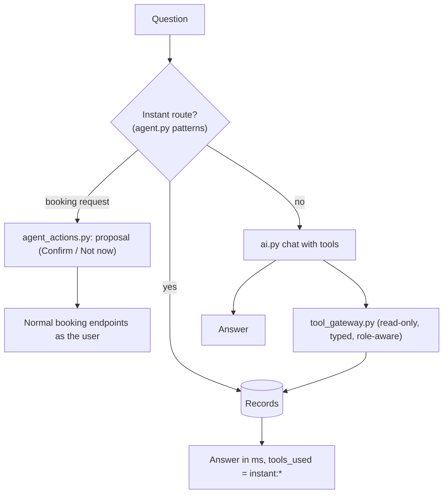

# Agent architecture

| Component | File | Responsibility |
|---|---|---|
| Chat and provider selection | `backend/app/services/ai.py` | Prompt, tool-calling loop, provider (Ollama or Claude API) |
| Instant answers and history | `backend/app/services/agent.py`, `agent_history.py` | Pattern-routed answers straight from the database |
| Actions | `backend/app/services/agent_actions.py` | Booking create/cancel **proposals** only; the user confirms; doors, relays and robots are out of reach |
| Tool gateway | `backend/app/services/tool_gateway.py` | One gateway for the read-only tools; also exposed to MCP clients via `/api/tools` (`tools/mcp_server/server.py`) |
| System guide | `backend/app/services/ai_guide.py` | Plain-language description of how the lab works, free of secrets and addresses |
| Knowledge agent | `tools/knowledge/agent.py`, `serve.py` | Project questions with sources (separate process) |
| Robot control client | `backend/app/services/ur_agent.py` | Read state and pass Home/Stop to the guarded UR5e local agent; **unavailable** until commissioning is signed off |
