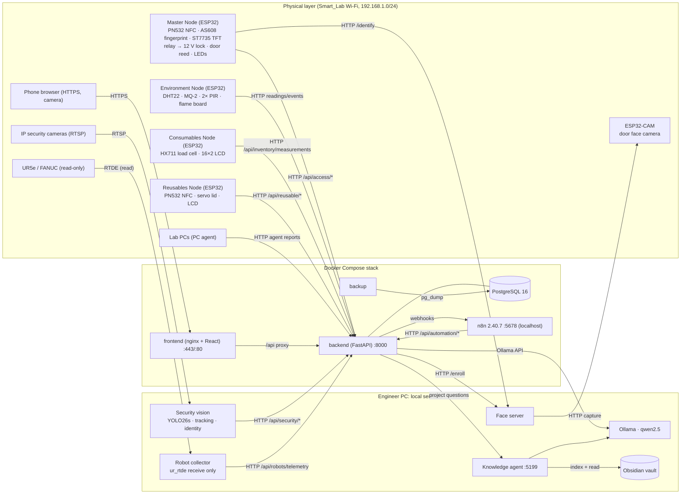
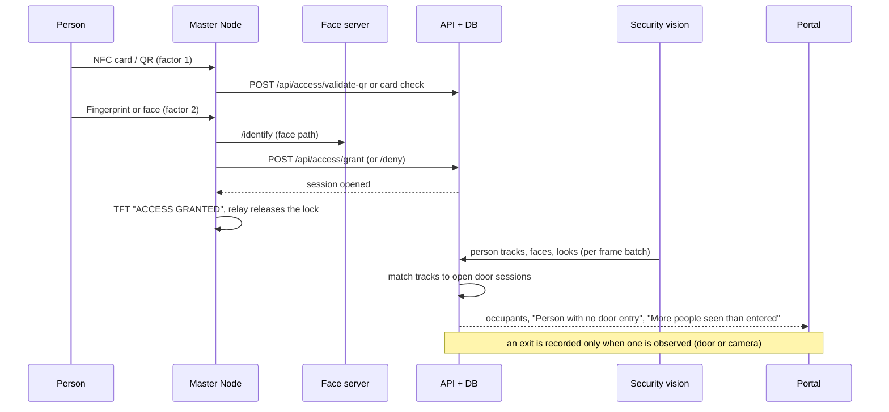

# Master system architecture

The platform is one backend (FastAPI + PostgreSQL) that every device, service and user interface reports to over the local network. ESP32 nodes, camera services, the robot collector and the PC agents send HTTP requests to the API; the portal, phones and n8n read and act through the same API. The AI assistants and the knowledge agent run on local models. Every arrow below was checked against the code on 9 November 2026.

Diagram sources: [master-system-architecture.mmd](master-system-architecture.mmd), [network-architecture.mmd](network-architecture.mmd), [data-flow.mmd](data-flow.mmd), [ai-automation-architecture.mmd](ai-automation-architecture.mmd), [digital-twin-ar-architecture.mmd](digital-twin-ar-architecture.mmd).

## 1. Components and protocols

Protocol facts: there is **no MQTT broker, PLC or Raspberry Pi** in the running system (searched: no MQTT client in backend or firmware). Devices use plain HTTP to the API with per-device keys; cameras use RTSP to the vision service only; robots are read with `ur_rtde` receive interfaces and never commanded.

## 2. Access to presence (the core integration)

Detection, identity and presence are separate steps; see [tracking-and-presence.md](../computer-vision/tracking-and-presence.md).

## 3. Layers

| Layer | What it contains | Code |
|---|---|---|
| Hardware nodes | Master, Environment, Consumables, Reusables, ESP32-CAM | `firmware/` |
| Vision | YOLO26s person detection, tracking, identity evidence, equipment zones | `tools/security_vision/` |
| Robots | UR5e RTDE and FANUC read-only collectors, twin | `tools/robot_monitor/`, `tools/ur5e_collector/`, `frontend/src/components/robot/` |
| PCs | PC agent, screen wall, screen sharing, exam mode | `tools/pc_agent/`, `frontend/src/components/ScreenShare.tsx` |
| Backend | 329 API operations, rules, alerts, sessions, reports | `backend/app/` |
| Data | PostgreSQL 16, 42 tables, nightly backups | `backend/app/models/`, `backend/alembic/` |
| Portal | React 18 + Vite 6 + Tailwind 3.4 | `frontend/src/` |
| AI | Lab assistant (Ollama, optional Claude API), knowledge agent | `backend/app/services/ai.py`, `agent.py`, `tools/knowledge/` |
| Knowledge | Obsidian vault built from the repository | `tools/knowledge/kb.py`, `docs/knowledge/obsidian/vault/` |
| Automation | 23 n8n workflows; the backend decides, n8n schedules and notifies | `automation/n8n/` |
| AR | Phone "Scan the lab": QR markers decoded on the phone, live records pinned | `frontend/src/pages/Scan.tsx`, `routes/scan.py` |

More detail: [network](../deployment/local-network-and-offline.md), [hardware](../hardware/), [software](../software/), [AI](../ai/), [automation](../automation/n8n-overview.md).
