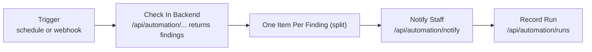

# n8n: workflow orchestration

n8n (self-hosted, `n8nio/n8n:2.40.7`, pinned because "latest" could change under the workflows) runs in the Docker stack on `127.0.0.1:5678`. It starts only when `AUTOMATION_WEBHOOK_BASE` is set in `.env`.

**Division of work:** n8n supplies schedules, webhook triggers, fan-out and notifications; **the backend makes every decision** (`backend/app/api/routes/automation.py`, `backend/app/services/automation.py`). n8n never does computer vision, access control or door decisions.

That pattern covers most of the 23 workflows; reports (06 daily, 07 weekly, 22 robotics daily) call a report endpoint and send it to administrators. Examples of cross-system rules: **16 Stock change with nobody inside** (consumables × access sessions), **03 Access denial intelligence**, **13 Environment hazard escalation**, **19 Robot running without a booking**, **23 Emergency: warn people inside, check the door**.

Inventory with triggers, steps and endpoints: [workflow-inventory.md](workflow-inventory.md). Deployment: [workflow-deployment.md](workflow-deployment.md). Credentials: [credentials-and-security.md](credentials-and-security.md). Troubleshooting: [workflow-troubleshooting.md](workflow-troubleshooting.md).
