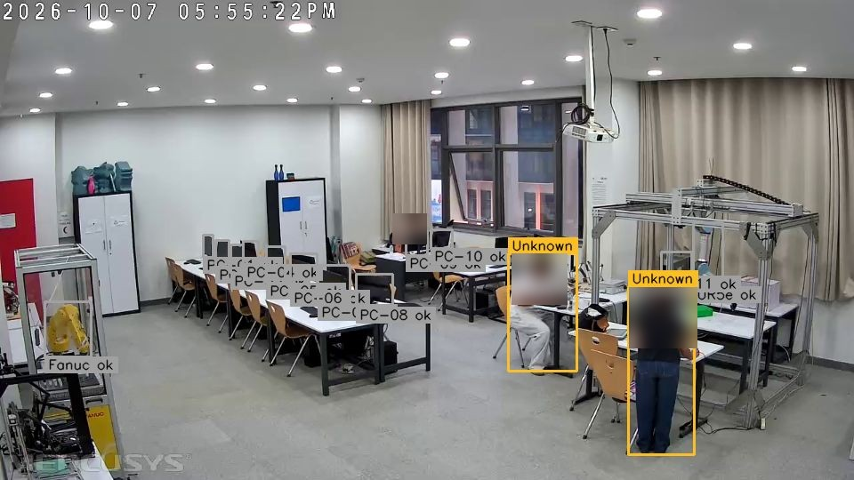

# Vision system

Code: [`tools/security_vision/`](../../tools/security_vision/) (service `security_vision.py`, engine `vision.py`, identity `identity.py`, two-camera naming `crosscam.py`) · runs natively on the engineer PC (Python 3.14, OpenCV 4.10, onnxruntime-directml), one process per camera, ports 5100 / 5101 on localhost.

## Pipeline

| Step | What happens | Code |
|---|---|---|
| 1. Frames | RTSP from the IP camera (Mercusys MC210 / MC200, or any RTSP/ONVIF camera) through OpenCV/FFmpeg. A latest-frame buffer drops old frames, so analysis never falls behind | `security_vision.py` |
| 2. Detection | YOLO26s (Ultralytics weights, exported to ONNX at 544×960) finds people. Engine order: GPU via DirectML → OpenVINO/CPU onnxruntime → OpenCV `cv2.dnn`; YOLOX-S is the older fallback model | `vision.py` `Yolo26Detector` |
| 3. Tracking | Each box is matched to a track by overlap with where the track was heading (constant-speed prediction) and, when available, by appearance, so two people crossing keep their own ids. A track survives misses of up to 2 s (`MAX_MISS_S`) | `vision.py` `Tracker` |
| 4. Identity evidence | A name is attached only from evidence: the person's own door entry (first seen in the door area within 25 s of a grant), a clear face match, a stored "look", or one-name-left logic. Otherwise the person stays **Unknown** | `identity.py`, `vision.py` `Identity` |
| 5. Zones | Equipment boxes (PCs, robots) learnt when empty; changes raise "Equipment moved or missing" or "Movement at equipment with nobody there" | `vision.py` `ZoneWatcher` |
| 6. Report | Tracks, names, counts and events go to the API (`/api/security/*`) with the device key; event snapshots only | API `security.py` |

Measured on the development laptop (GTX 1650): about 7 analysis passes per second for one camera; details in [CV_BENCHMARK_2026-10-26.md](../CV_BENCHMARK_2026-10-26.md).

## Privacy

The stream is never opened to the network (the service listens on 127.0.0.1 and the portal fetches frames with the device key). Nothing is recorded except event snapshots, deleted 30 days after staff review. The camera never actuates anything. Faces in published figures are blurred; face enrolment data stays on the engineer PC and is not in this repository.

See also: [yolo-models.md](yolo-models.md) · [tracking-and-presence.md](tracking-and-presence.md) · [access-camera-integration.md](access-camera-integration.md) · [limitations-and-validation.md](limitations-and-validation.md).
