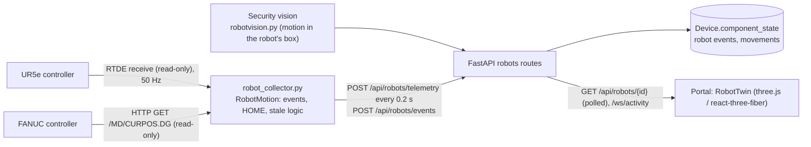

# Digital twin: architecture

| Part | File |
|---|---|
| Collector (UR and FANUC sources, motion detection, back-off when unreachable) | [`tools/robot_monitor/robot_collector.py`](../../tools/robot_monitor/robot_collector.py) |
| Backend routes: state, events, movements, control status | [`backend/app/api/routes/robots.py`](../../backend/app/api/routes/robots.py) |
| 3D twin and panel | [`frontend/src/components/robot/RobotTwin.tsx`](../../frontend/src/components/robot/RobotTwin.tsx), `RobotTwinPanel.tsx`, `robotLive.tsx` |
| Kinematics and joint limits | `frontend/src/components/robot/kinematics.ts` |
| Robot detail page | [`frontend/src/pages/RobotDetail.tsx`](../../frontend/src/pages/RobotDetail.tsx) |

Camera fusion: if the camera sees motion in the robot's box while telemetry is stale, the backend raises VISUAL_MOVEMENT_DURING_TELEMETRY_OUTAGE.
