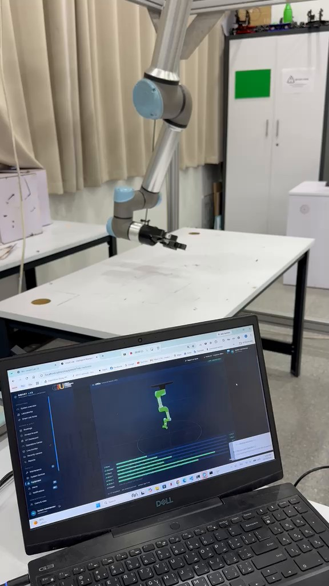

# Digital twin: overview

The portal shows a 3D twin of each lab robot, driven by that robot's own telemetry. It is a **monitoring twin**: it mirrors joint positions and states, read-only. Nothing in the twin, the backend or the collector can command a robot (a test enforces that the backend has no controller endpoint). Deeper documents: [ROBOTS.md](../ROBOTS.md), [FANUC_LIVE_TWIN.md](../FANUC_LIVE_TWIN.md), [ROBOT_CONTROL.md](../ROBOT_CONTROL.md) (control adapters stay **unavailable** until a commissioning step is signed off).

| Robot | Telemetry source | Status |
|---|---|---|
| UR5e | `ur_rtde` **receive** interface (RTDE), sampled at 50 Hz by `tools/robot_monitor/robot_collector.py`, latest state sent every 0.2 s | Implemented; twin moving with the robot was recorded in the lab (portal recording and photo, Oct 2026) |
| FANUC ER-4iA (R-30iB Mate Plus) | The controller's web page `GET /MD/CURPOS.DG` only, about 4 polls/s | **Live-verified read-only on 14 Oct 2026** at 192.168.1.100: the twin followed the pendant at about 3 samples/s (one session; J2/J3 coupling still to be confirmed by pose) |
| Simulated robots | Built-in simulation for demos and tests | Labelled SIM in the portal |

What the twin shows: every joint (position, limits), robot mode, safety mode, telemetry age and quality, motion events, HOME status, and the camera's own view of motion in the robot's box. Without fresh telemetry (2 s) it shows **TELEMETRY STALE**, never "stationary".

See: [architecture.md](architecture.md) · [physical-state-mapping.md](physical-state-mapping.md) · [models-and-assets.md](models-and-assets.md) · [limitations.md](limitations.md).
