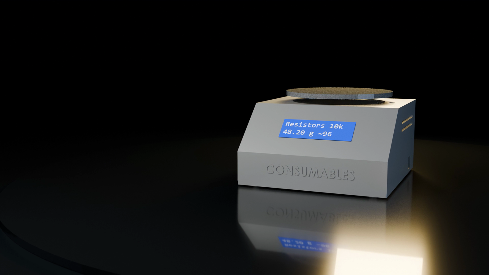

# Consumables Node (weighing bin)

Firmware: [`firmware/SmartLab_Consumable_Bin/`](../../firmware/SmartLab_Consumable_Bin/) · bring-up and calibration: [its README](../../firmware/SmartLab_Consumable_Bin/README.md) · device `BIN_NODE_1`, bin `BIN-R10K`.

## Role

A removable bin sits on a weighing plate over a 1 kg straight-bar load cell. The node turns mass into an estimated piece count and reports each measurement, so the portal knows stock levels and who took parts while a session was open.

## Components and pins (from the firmware)

| Part | Interface | ESP32 pins |
|---|---|---|
| 1 kg load cell + HX711 amplifier | 2-wire | DT 32, SCK 33 |
| 16×2 LCD | I²C (address found by scan) | SDA 21, SCL 22 |

LCD line 1 shows the item name (or the bin code); line 2 shows the mass and the estimated count, for example `48.20 g ~96`, with `SETTLING...`, `NOT CALIBRATED` or `OVER 1000 g!` when relevant and `!` when the network is down.

## Data flow

`POST /api/inventory/measurements` carries the mass; the backend computes the count from the unit mass and returns `qty_est`. Rules and workflows use it: **15 Consumable below reorder level** and **16 Stock change with nobody inside** (a withdrawal recorded while no access session was open: "a record to check, never an accusation").

## Status

| Item | Status |
|---|---|
| Firmware, portal integration, LCD format | Implemented; device registered and used in the lab |
| Calibration accuracy, noise, drift | **Not measured**: the calibration table in docs/BRINGUP_LOG.md (Phase 3) is still empty |
| README header "not yet run on hardware" | Outdated wording, kept until the measurement table is filled |
