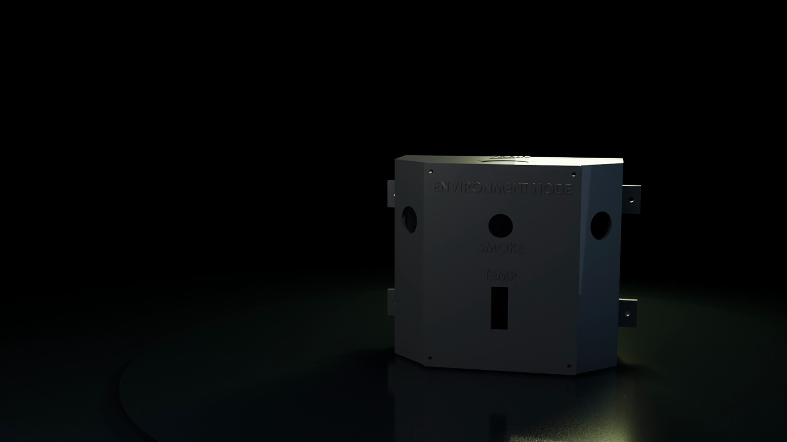

# Physical Environment Node

Firmware: [`firmware/SmartLab_Environment_Node/`](../../firmware/SmartLab_Environment_Node/) (ENVIRONMENT_NODE 0.1.0) · full wiring and bring-up: [its README](../../firmware/SmartLab_Environment_Node/README.md) · device `ENV_LAB01`, IP 192.168.1.152.

**It monitors only:** it senses and reports, and never switches anything. It is **not a certified fire or gas detector**; the MQ-2 and the flame board are indicators that raise portal alerts. A certified life-safety system is still required in any real facility.

## Sensors and pins (from `env_config.h`)

| Sensor | Measures | ESP32 pin | Bench result (BRINGUP_LOG, 5 Oct 2026) |
|---|---|---|---|
| DHT22 | Temperature, humidity (every 2.5 s) | GPIO 4 | PASS: readings, breath test, threshold events with hysteresis, unplug → SENSOR_FAILURE → recovery |
| PIR 1, PIR 2 (HC-SR501-type) | Motion in two zones | GPIO 27, GPIO 26 | PASS: independent zones; range and angle not measured |
| MQ-2 | Smoke / combustible gas (analog, through a 10k/15k divider) | AO GPIO 39, DO GPIO 25 | Bench tested; thresholds by rise above baseline (warning +400 mV, critical +700 mV) |
| 5-channel flame board | IR flame, with direction from the channel | GPIO 13, 32, 33, 35, 36 | PASS: detection, clearing, channel mapping; distance per channel not measured |

Each sensor is enabled at run time (`fit <sensor> on`, stored in flash), so an unfitted sensor never produces false readings.

Board: ESP32-WROOM-32 DevKit (ESP32-D0WD-V3), CH340 USB. Power: 3.3 V from the ESP32 for the DHT22; 5 V from an XL4016 buck for the PIRs and MQ-2; all grounds common.

## Data flow

Readings and events (HUMIDITY_HIGH, MOTION_STARTED, smoke or flame warnings, sensor failures) go to the API over HTTP on their own FreeRTOS task, so a slow network never blocks sensing. The backend raises alerts such as **"Smoke/gas detected at {lab}"** and **"Motion detected in {lab}"**; n8n workflows 08 (sensor thresholds) and 13 (environment hazard escalation) notify staff.
