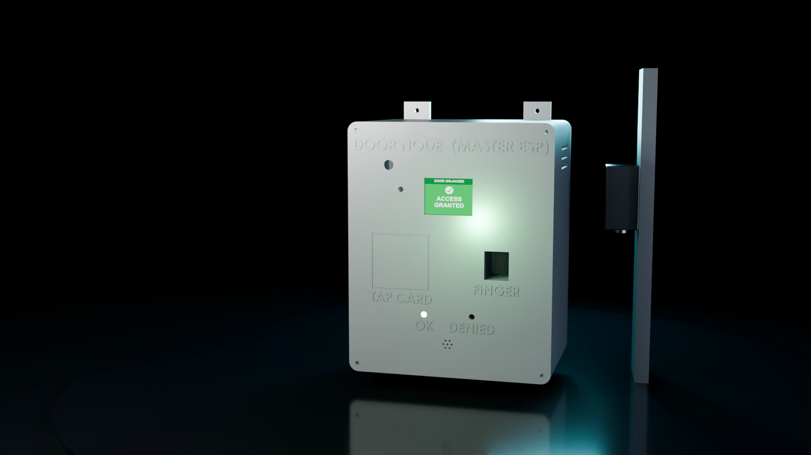

# Master Node (door access)

Firmware: [`firmware/SmartLab_Master_Portal/SmartLab_Master_Portal.ino`](../../firmware/SmartLab_Master_Portal/SmartLab_Master_Portal.ino) · Wiring record: [DOOR_MASTER_WIRING.md](DOOR_MASTER_WIRING.md) · Enclosure CAD: [`tools/cad/release_2026-10-25/1_MasterDoor`](../../tools/cad/release_2026-10-25/) · Device `MASTER_LAB01`, lab `LAB_01`.

## Role

The Master Node controls the lab door. It runs the two-factor access sequence, drives the 12 V solenoid lock through a relay, watches the door contact, shows each step on its TFT screen, and reports every grant, denial, door event and heartbeat to the API. It is also the node the camera system's presence cross-check relies on: an occupant is "entered" only after the Master Node reports the grant.

## Components and pins (from the firmware constants)

| Part | Interface | ESP32 pins |
|---|---|---|
| ESP32 DevKit (classic ESP32) | - | - |
| PN532 V3 NFC reader | I²C, address 0x24 | SDA 19, SCL 18 |
| AS608-protocol fingerprint sensor | UART | RX 16, TX 17 |
| ST7735 1.8" TFT, 160×128 | SPI | SCK 13, MOSI 2, CS 25, DC 32, RST 33 |
| Relay module → 12 V solenoid lock (on NO contact: fail-secure) | GPIO through an NPN stage (rebuilt 8 Nov 2026) | 26 |
| Door contact (reed) | input | 27 |
| Green LED (granted) | output | 14 |
| Red LED (denied) | output | 15 |
| Red LED + buzzer (denial alert) | through an NPN stage | 21 |
| Door audio | PWM | 22 |

Wi-Fi credentials and the device key live in `secrets.h` (git-ignored; template [`secrets.example.h`](../../firmware/SmartLab_Master_Portal/secrets.example.h)).

## Access sequence

1. **Factor 1:** an NFC card or a time-bound booking QR code (checked at `POST /api/access/validate-qr`).
2. **Factor 2:** fingerprint (on the sensor) or face (the Master Node asks the face server's `/identify`, which captures from the door ESP32-CAM).
3. The API records `POST /api/access/grant` (or `/deny` with the reason) and opens an access session.
4. The TFT shows the grant screen ("DOOR UNLOCKED · ACCESS GRANTED" with the user's name), the green LED lights and the relay releases the lock for the configured time. The door contact then reports open and closed; the lock re-engages when the door closes.
5. Denials light the red LED, beep, and keep the door locked.

Other endpoints used: `/api/access/events`, `/heartbeat`, `/telemetry`, `/commands/` (staff commands such as remote unlock, polled by the node).

## Safety behaviour

- **Fail-secure:** the lock is wired on the relay's NO contact, so a reset, a flash or a power loss leaves the door locked (bench-validated 5 Oct 2026).
- **Boot glitch fixed (8 Nov 2026):** the firmware now writes the locked level before configuring the pin as an output, and the relay is driven through an NPN stage from 5 V. The owner confirmed: no unlock on reset or replug, and the lock stays closed with the ESP32 unpowered.
- **Alarms:** "door held open" and forced entry pulse the buzzer; an evacuation command from the portal is supported by the firmware (portal path not yet re-tested on the current build).
- Physical exit always works mechanically; the system never traps anyone.

## Status

| Item | Status |
|---|---|
| NFC, QR, fingerprint, TFT, relay on NO, LEDs, buzzer | Verified on the bench (BRINGUP_LOG, 5 Oct 2026) |
| Relay boot fix | Verified by the owner (8 Nov 2026) |
| NPN part number and resistor values of the new stage | Not recorded yet |
| Maximum lock-energised time | Owner decision pending |
| Face as factor 2 | Implemented; depends on the face server running on the engineer PC |
