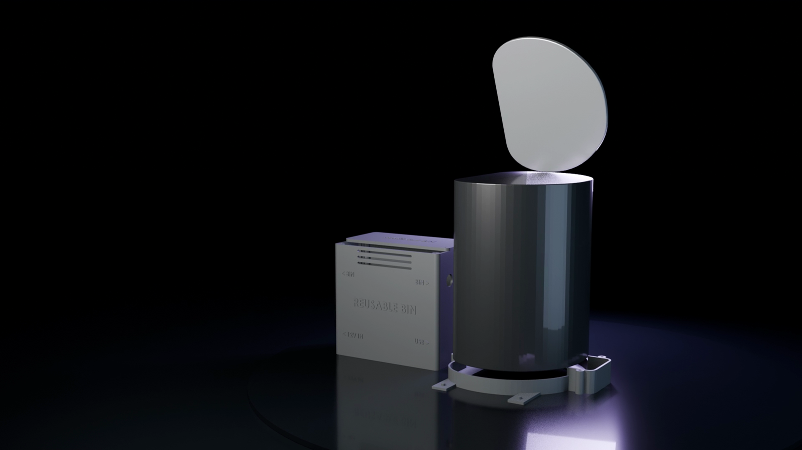

# Reusables Node (NFC check-out bin with servo lid)

Firmware: [`firmware/SmartLab_Reusable_Bin/`](../../firmware/SmartLab_Reusable_Bin/) (single-file, reuse-0.3) and the newer [`firmware/SmartLab_Reusable_Bin_Modular/`](../../firmware/SmartLab_Reusable_Bin_Modular/) (same portal API) · enclosure: floor dock, [`tools/cad/release_2026-10-25/4_ReusableBinDock`](../../tools/cad/release_2026-10-25/) · device `REUSE_BIN_1`.

## Role

Shared equipment (tools, meters, kits) is kept in a bin whose lid opens on an NFC tap. The scan identifies the card holder and the item, the servo opens the lid, and the check-out is logged; overdue items raise an alert (workflow **17 Reusable item overdue**).

## Components and pins (single-file firmware constants)

| Part | Interface | ESP32 pins |
|---|---|---|
| PN532 NFC reader | I²C, address 0x24 | SDA 21, SCL 22 |
| 16×2 LCD | same I²C bus | SDA 21, SCL 22 |
| MG90S servo (lid) | PWM, powered from the 5 V branch rail | GPIO 13 |
| Lid reed switch | input | GPIO 27 |
| Load cell + HX711 (bin contents check) | 2-wire | DT 25, SCK 26 |

Endpoints: `POST /api/reusable/scan` (tap) and `/api/reusable/complete` (lid closed, transaction finished).

## Status

| Item | Status |
|---|---|
| Firmware and portal flow | Implemented (both firmware variants compile) |
| Bench | Partially verified: NFC reading and the lid-on-scan flow were exercised on the bench (9 Oct 2026); servo current and load-cell values marked `VERIFY` in the modular firmware are not measured |
| README "not yet run on hardware" | Conflicts with the bench notes above; treat the node as a **prototype under bring-up** |
