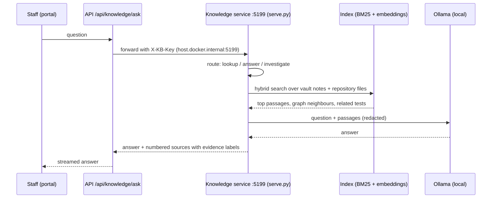

# AI context integration

| Item | Detail |
|---|---|
| Access | Staff only; the service listens on 127.0.0.1 and requires `X-KB-Key` (from `tools/knowledge/config.json`, git-ignored) |
| Ingestion | `kb.py scan` registers approved sources with hashes and redactions; `kb.py build` writes notes and the index |
| File types | Markdown, Python, TypeScript/TSX, firmware sources, JSON workflow exports and other text files on the approved list |
| Refresh | On demand (`kb.py build`); notes show their build time. The vault is not watched live |
| Redaction | Literal values listed in the config (for example default passwords) are removed before text reaches the model |
| Evidence labels | VERIFIED_CURRENT (repo file / test), DOCUMENTED (repo), HISTORICAL; workflow notes say the live n8n state is separate |
| Failure handling | No model → search results only; timeouts reported; never invents a source |

Example (8 Nov 2026): "What is the current operational status of the lab?" → route *answer*, retrieval 6.9 s, total 33.8 s, three cited files (`backend/app/services/agent.py`, `docs/STATUS_REPORT_2026-10-28.md`, `backend/app/api/routes/system.py`).
