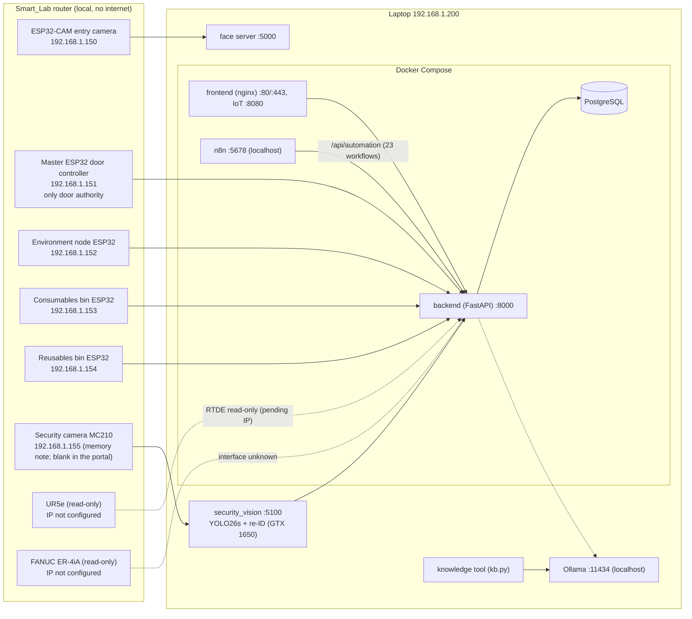

# Master system map

> Solid lines: verified in code/config or the portal's device list (2026-10-13). Dashed: reported, not re-verified.
> Addresses from the portal's registered devices; the robots' own addresses are **not configured** yet.

Related: [[Door and access]] · [[SecurityCam (vision)]] · [[Robots (read-only)]] · [[Consumables bin]] · [[Reusables bin]] ·
[[Environment monitoring]] · [[n8n automation]] · [[Backend and data]] · [[Database-Data-Dictionary]]
