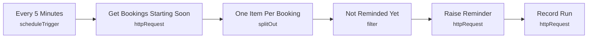

# Smart Lab 02 - Upcoming booking reminders

> Generated from `automation/n8n/json/02-booking-reminders.json` (sha256 1f940607da49). Configured behaviour, not observed runs.

## Live state
**active** in the running n8n (export of 2026-11-04T00:02:25+02:00). Nodes and connections match this file.

## Purpose
## Upcoming booking reminders
Idempotent: the backend raises at most one reminder per booking - shared with the portal's own lazy reminder, so a retry or both paths firing never sends two.

## Triggers
- scheduleTrigger: `{"interval": [{"field": "minutes", "minutesInterval": 5}]}`

## Flow

## Endpoints called (host redacted)
- `GET <host>/api/automation/bookings/upcoming?within_minutes=20` - Get Bookings Starting Soon
- `POST =<host>/api/automation/bookings/{{ $json.booking_id }}/remind` - Raise Reminder
- `POST <host>/api/automation/runs` - Record Run

## Changes data
Yes - uses POST/PUT/PATCH/DELETE

## Credentials (references only, never values)
- httpHeaderAuth:Smart Lab automation key

## External services
- none found: all calls go to the local backend

## Related
- [[Bookings and labs]] (system)
- [[backend_app_api_routes_automation.py]] (code it calls)
- [[n8n automation]] (system)

Back to [[Home]] · [[Workflow catalogue]]
