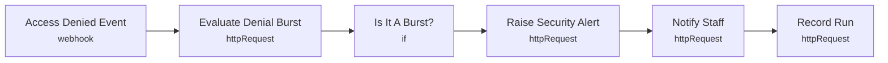

# Smart Lab 03 - Access denial intelligence

> Generated from `automation/n8n/json/03-access-denial-intelligence.json` (sha256 757cd1a39771). Configured behaviour, not observed runs.

## Live state
**active** in the running n8n (export of 2026-11-04T00:02:25+02:00). Nodes and connections match this file.

## Purpose
## Access denial intelligence
1 refusal = normal (early, wrong code). 3 within 10 min = warning (thresholds in backend config). One alert per burst via dedupe key.

This workflow NEVER locks or unlocks anything - the door decides on its own.

## Triggers
- webhook: `"smartlab-access-denied"`

## Flow

## Endpoints called (host redacted)
- `GET =<host>/api/automation/access/denials{{ $json.body.lab_id ? "?lab_id=" + $json.body.lab_id : "" }}` - Evaluate Denial Burst
- `POST <host>/api/automation/alerts` - Raise Security Alert
- `POST <host>/api/automation/notify` - Notify Staff
- `POST <host>/api/automation/runs` - Record Run

## Changes data
Yes - uses POST/PUT/PATCH/DELETE

## Credentials (references only, never values)
- httpHeaderAuth:Smart Lab automation key
- httpHeaderAuth:Smart Lab webhook token

## External services
- none found: all calls go to the local backend

## Related
- [[Door and access]] (system)
- [[backend_app_api_routes_automation.py]] (code it calls)
- [[n8n automation]] (system)

Back to [[Home]] · [[Workflow catalogue]]
