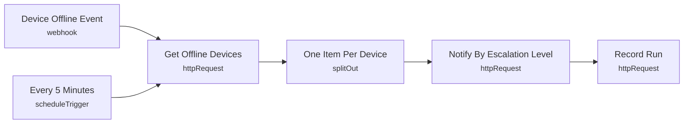

# Smart Lab 04 - Device offline alert with escalation

> Generated from `automation/n8n/json/04-device-offline-escalation.json` (sha256 5c6c8d0d3a1a). Configured behaviour, not observed runs.

## Live state
**active** in the running n8n (export of 2026-11-04T00:02:25+02:00). Nodes and connections match this file.

## Purpose
## Device offline escalation
Level 1 at the stale threshold -> staff; level 2 at 15 min -> staff again; level 3 at 60 min -> administrators, critical. One notification per outage per level (dedupe key).
The scheduled scan also makes the backend record new outages when nobody has the portal open.

## Triggers
- webhook: `"smartlab-device-offline"`
- scheduleTrigger: `{"interval": [{"field": "minutes", "minutesInterval": 5}]}`

## Flow

## Endpoints called (host redacted)
- `GET <host>/api/automation/devices/offline` - Get Offline Devices
- `POST <host>/api/automation/notify` - Notify By Escalation Level
- `POST <host>/api/automation/runs` - Record Run

## Changes data
Yes - uses POST/PUT/PATCH/DELETE

## Credentials (references only, never values)
- httpHeaderAuth:Smart Lab automation key
- httpHeaderAuth:Smart Lab webhook token

## External services
- none found: all calls go to the local backend

## Related
- [[backend_app_api_routes_automation.py]] (code it calls)
- [[n8n automation]] (system)

Back to [[Home]] · [[Workflow catalogue]]
