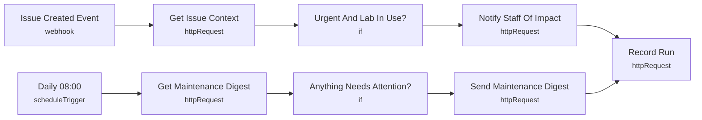

# Smart Lab 05 - Maintenance automation

> Generated from `automation/n8n/json/05-maintenance-automation.json` (sha256 60fa0806d80e). Configured behaviour, not observed runs.

## Live state
**active** in the running n8n (export of 2026-11-04T00:02:25+02:00). Nodes and connections match this file.

## Purpose
## Maintenance automation
Event path: a HIGH/CRITICAL issue in a lab with bookings in the next 24 h is flagged to staff at once.
Daily path: overdue (per published SLA), urgent unassigned, and equipment due for maintenance within 7 days.

## Triggers
- webhook: `"smartlab-issue-created"`
- scheduleTrigger: `{"interval": [{"triggerAtHour": 8}]}`

## Flow

## Endpoints called (host redacted)
- `GET =<host>/api/automation/issues/{{ $json.body.object.id }}` - Get Issue Context
- `POST <host>/api/automation/notify` - Notify Staff Of Impact
- `POST <host>/api/automation/runs` - Record Run
- `GET <host>/api/automation/maintenance` - Get Maintenance Digest
- `POST <host>/api/automation/notify` - Send Maintenance Digest

## Changes data
Yes - uses POST/PUT/PATCH/DELETE

## Credentials (references only, never values)
- httpHeaderAuth:Smart Lab automation key
- httpHeaderAuth:Smart Lab webhook token

## External services
- none found: all calls go to the local backend

## Related
- [[backend_app_api_routes_automation.py]] (code it calls)
- [[n8n automation]] (system)

Back to [[Home]] · [[Workflow catalogue]]
