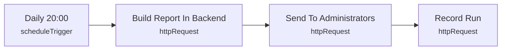

# Smart Lab 06 - Daily lab report

> Generated from `automation/n8n/json/06-daily-report.json` (sha256 c7416e9793f9). Configured behaviour, not observed runs.

## Live state
**active** in the running n8n (export of 2026-11-04T00:02:25+02:00). Nodes and connections match this file.

## Purpose
## Daily lab report
The backend computes every figure from recorded rows (no estimates); n8n only schedules and delivers. Idempotent per day via dedupe key. Add an Email/Slack node in parallel to Send To Administrators for an external channel.

## Triggers
- scheduleTrigger: `{"interval": [{"field": "days", "triggerAtHour": 20}]}`

## Flow

## Endpoints called (host redacted)
- `GET <host>/api/automation/reports/daily` - Build Report In Backend
- `POST <host>/api/automation/notify` - Send To Administrators
- `POST <host>/api/automation/runs` - Record Run

## Changes data
Yes - uses POST/PUT/PATCH/DELETE

## Credentials (references only, never values)
- httpHeaderAuth:Smart Lab automation key

## External services
- none found: all calls go to the local backend

## Related
- [[backend_app_api_routes_automation.py]] (code it calls)
- [[n8n automation]] (system)

Back to [[Home]] · [[Workflow catalogue]]
