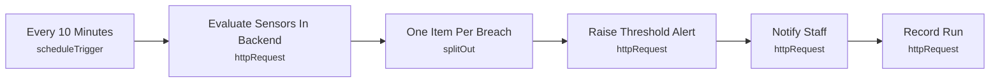

# Smart Lab 08 - Sensor threshold alerts

> Generated from `automation/n8n/json/08-sensor-thresholds.json` (sha256 9816c053dcb9). Configured behaviour, not observed runs.

## Live state
**active** in the running n8n (export of 2026-11-04T00:02:25+02:00). Nodes and connections match this file.

## Purpose
## Sensor thresholds (configuration-driven)
Thresholds live in backend SENSOR_THRESHOLDS (metric=min:max). Stale readings are never treated as OK. With no sensor node installed the backend returns no_data and this workflow does nothing - no simulated values.

## Triggers
- scheduleTrigger: `{"interval": [{"field": "minutes", "minutesInterval": 10}]}`

## Flow

## Endpoints called (host redacted)
- `GET <host>/api/automation/sensors/evaluate?max_age_minutes=30` - Evaluate Sensors In Backend
- `POST <host>/api/automation/alerts` - Raise Threshold Alert
- `POST <host>/api/automation/notify` - Notify Staff
- `POST <host>/api/automation/runs` - Record Run

## Changes data
Yes - uses POST/PUT/PATCH/DELETE

## Credentials (references only, never values)
- httpHeaderAuth:Smart Lab automation key

## External services
- none found: all calls go to the local backend

## Related
- [[Environment monitoring]] (system)
- [[backend_app_api_routes_automation.py]] (code it calls)
- [[n8n automation]] (system)

Back to [[Home]] · [[Workflow catalogue]]
