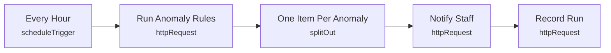

# Smart Lab 12 - Rule-based anomaly detection

> Generated from `automation/n8n/json/12-anomaly-detection.json` (sha256 0bbdac57e06e). Configured behaviour, not observed runs.

## Live state
**active** in the running n8n (export of 2026-11-04T00:02:25+02:00). Nodes and connections match this file.

## Purpose
## Rule-based anomaly detection
Explainable rules only, evaluated in the backend: denial bursts, repeated identity mismatch, after-hours access, forced entry / door held open, device flapping, refusals far above the lab's own 7-day baseline. No ML model - there is no training data. One notification per rule, lab and day.

## Triggers
- scheduleTrigger: `{"interval": [{"field": "hours", "hoursInterval": 1}]}`

## Flow

## Endpoints called (host redacted)
- `GET <host>/api/automation/anomalies?hours=24` - Run Anomaly Rules
- `POST <host>/api/automation/notify` - Notify Staff
- `POST <host>/api/automation/runs` - Record Run

## Changes data
Yes - uses POST/PUT/PATCH/DELETE

## Credentials (references only, never values)
- httpHeaderAuth:Smart Lab automation key

## External services
- none found: all calls go to the local backend

## Related
- [[backend_app_api_routes_automation.py]] (code it calls)
- [[n8n automation]] (system)

Back to [[Home]] · [[Workflow catalogue]]
