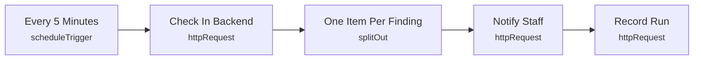

# Smart Lab 13 - Environment hazard escalation

> Generated from `automation/n8n/json/13-environment-hazard-escalation.json` (sha256 b67afba84d58). Configured behaviour, not observed runs.

## Live state
**active** in the running n8n (export of 2026-11-04T00:02:25+02:00). Nodes and connections match this file.

## Purpose
## Environment hazard escalation
The backend alerts at once when smoke, flame, a leak or the emergency signal is reported; this re-notifies when it is still active after 5 min. Indicators only - not a certified fire or safety system.

## Triggers
- scheduleTrigger: `{"interval": [{"field": "minutes", "minutesInterval": 5}]}`

## Flow

## Endpoints called (host redacted)
- `GET <host>/api/automation/robotics/hazards` - Check In Backend
- `POST <host>/api/automation/notify` - Notify Staff
- `POST <host>/api/automation/runs` - Record Run

## Changes data
Yes - uses POST/PUT/PATCH/DELETE

## Credentials (references only, never values)
- httpHeaderAuth:Smart Lab automation key

## External services
- none found: all calls go to the local backend

## Related
- [[Environment monitoring]] (system)
- [[backend_app_api_routes_automation.py]] (code it calls)
- [[n8n automation]] (system)

Back to [[Home]] · [[Workflow catalogue]]
