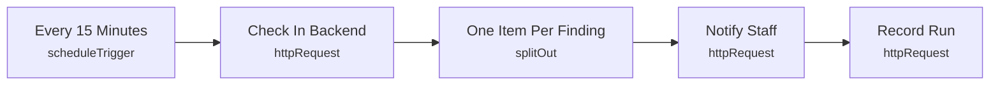

# Smart Lab 14 - Environment / bin node offline

> Generated from `automation/n8n/json/14-node-offline.json` (sha256 bd915fbdd064). Configured behaviour, not observed runs.

## Live state
**active** in the running n8n (export of 2026-11-04T00:02:25+02:00). Nodes and connections match this file.

## Purpose
## Environment / bin node offline
A sensor or bin node stopped sending heartbeats - its readings are stale, never shown as current.

## Triggers
- scheduleTrigger: `{"interval": [{"field": "minutes", "minutesInterval": 15}]}`

## Flow

## Endpoints called (host redacted)
- `GET <host>/api/automation/robotics/env-offline` - Check In Backend
- `POST <host>/api/automation/notify` - Notify Staff
- `POST <host>/api/automation/runs` - Record Run

## Changes data
Yes - uses POST/PUT/PATCH/DELETE

## Credentials (references only, never values)
- httpHeaderAuth:Smart Lab automation key

## External services
- none found: all calls go to the local backend

## Related
- [[Environment monitoring]] (system)
- [[backend_app_api_routes_automation.py]] (code it calls)
- [[n8n automation]] (system)

Back to [[Home]] · [[Workflow catalogue]]
