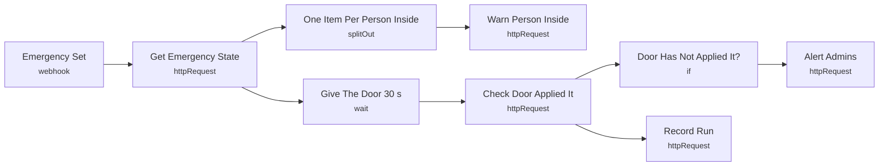

# Smart Lab 23 - Emergency: warn people inside, check the door

> Generated from `automation/n8n/json/23-emergency.json` (sha256 eaa7c7fddab6). Configured behaviour, not observed runs.

## Live state
**active** in the running n8n (export of 2026-11-04T00:02:25+02:00). Nodes and connections match this file.

## Purpose
## Emergency
Set by an admin in the Emergency tab. 1) Everyone INSIDE that lab gets a notice telling them what to do (leave / lockdown / the admin's message). 2) After 30 s: if the door controller has not confirmed the new state, the admins are told to act at the door.

This workflow NEVER opens or locks anything - the door applies the state itself.

## Triggers
- webhook: `"smartlab-emergency-set"`

## Flow

## Endpoints called (host redacted)
- `GET =<host>/api/automation/emergency/{{ $json.body.lab_id }}` - Get Emergency State
- `POST <host>/api/automation/notify` - Warn Person Inside
- `GET =<host>/api/automation/emergency/{{ $json.lab_id }}` - Check Door Applied It
- `POST <host>/api/automation/notify` - Alert Admins
- `POST <host>/api/automation/runs` - Record Run

## Changes data
Yes - uses POST/PUT/PATCH/DELETE

## Credentials (references only, never values)
- httpHeaderAuth:Smart Lab automation key
- httpHeaderAuth:Smart Lab webhook token

## External services
- none found: all calls go to the local backend

## Related
- [[Door and access]] (system)
- [[backend_app_api_routes_automation.py]] (code it calls)
- [[n8n automation]] (system)

Back to [[Home]] · [[Workflow catalogue]]
