# Database data dictionary

> Generated from the SQLAlchemy models (structure only, no data). 41 tables. Migrations: `backend/alembic/versions/`.

## Relationships (foreign keys)

```mermaid
erDiagram
  users ||--o{ rfid_credentials : user_id
  users ||--o{ personal_qr_credentials : user_id
  users ||--o{ personal_qr_credentials : issued_by_id
  labs ||--o{ devices : lab_id
  assets ||--o{ devices : asset_id
  labs ||--o{ lab_devices : lab_id
  devices ||--o{ lab_devices : device_id
  users ||--o{ bookings : user_id
  labs ||--o{ bookings : lab_id
  bookings ||--o{ booking_items : booking_id
  assets ||--o{ booking_items : asset_id
  inventory_bins ||--o{ booking_items : inventory_bin_id
  bookings ||--o{ qr_tokens : booking_id
  users ||--o{ qr_tokens : user_id
  labs ||--o{ qr_tokens : lab_id
  labs ||--o{ access_attempts : lab_id
  devices ||--o{ access_attempts : device_id
  users ||--o{ access_attempts : user_id
  bookings ||--o{ access_attempts : booking_id
  labs ||--o{ access_events : lab_id
  users ||--o{ access_events : user_id
  bookings ||--o{ access_events : booking_id
  devices ||--o{ access_events : device_id
  labs ||--o{ access_sessions : lab_id
  users ||--o{ access_sessions : user_id
  bookings ||--o{ access_sessions : booking_id
  devices ||--o{ access_sessions : device_id
  labs ||--o{ assets : lab_id
  users ||--o{ assets : holder_id
  assets ||--o{ asset_transactions : asset_id
  users ||--o{ asset_transactions : user_id
  labs ||--o{ asset_transactions : lab_id
  bookings ||--o{ asset_transactions : booking_id
  devices ||--o{ asset_transactions : device_id
  labs ||--o{ sensor_readings : lab_id
  devices ||--o{ sensor_readings : device_id
  labs ||--o{ alerts : lab_id
  devices ||--o{ alerts : device_id
  users ||--o{ alerts : acknowledged_by_id
  users ||--o{ alerts : owner_id
  users ||--o{ alerts : resolved_by_id
  alerts ||--o{ incident_notes : alert_id
  users ||--o{ incident_notes : user_id
  users ||--o{ audit_logs : actor_user_id
  users ||--o{ issues : reporter_id
  labs ||--o{ issues : lab_id
  assets ||--o{ issues : asset_id
  devices ||--o{ issues : device_id
  access_events ||--o{ issues : access_event_id
  users ||--o{ issues : assigned_to_id
  issues ||--o{ issue_photos : issue_id
  users ||--o{ issue_photos : uploaded_by_id
  issues ||--o{ issue_comments : issue_id
  users ||--o{ issue_comments : author_id
  issues ||--o{ issue_history : issue_id
  users ||--o{ issue_history : actor_id
  users ||--o{ notifications : user_id
  issues ||--o{ notifications : issue_id
  bookings ||--o{ notifications : booking_id
  devices ||--o{ device_commands : device_id
  users ||--o{ device_commands : target_user_id
  users ||--o{ device_commands : requested_by_id
  users ||--o{ face_submissions : user_id
  users ||--o{ face_submissions : reviewed_by_id
  labs ||--o{ inventory_bins : lab_id
  devices ||--o{ inventory_bins : device_id
  inventory_bins ||--o{ inventory_measurements : bin_id
  inventory_bins ||--o{ inventory_transactions : bin_id
  users ||--o{ inventory_transactions : user_id
  bookings ||--o{ inventory_transactions : booking_id
  users ||--o{ inventory_transactions : recorded_by_id
  devices ||--o{ equipment_sessions : device_id
  assets ||--o{ equipment_sessions : asset_id
  labs ||--o{ equipment_sessions : lab_id
  users ||--o{ equipment_sessions : user_id
  bookings ||--o{ equipment_sessions : booking_id
  devices ||--o{ policy_violations : device_id
  labs ||--o{ policy_violations : lab_id
  devices ||--o{ security_zones : device_id
  assets ||--o{ security_zones : asset_id
  devices ||--o{ security_events : device_id
  labs ||--o{ security_events : lab_id
  security_zones ||--o{ security_events : zone_id
  users ||--o{ security_events : acknowledged_by_id
  labs ||--o{ lab_emergencies : lab_id
  users ||--o{ lab_emergencies : updated_by_id
  users ||--o{ experiments : operator_id
  devices ||--o{ experiments : device_id
  experiments ||--o{ experiment_trials : experiment_id
  users ||--o{ experiment_trials : recorded_by_id
  devices ||--o{ robot_events : device_id
  labs ||--o{ robot_events : lab_id
  bookings ||--o{ robot_events : booking_id
  devices ||--o{ robot_home_calibrations : device_id
  users ||--o{ robot_home_calibrations : created_by_id
  users ||--o{ workcell_setups : created_by_id
```

## `access_attempts` (AccessAttempt, AccessAttempt line 335)
One row per credential presentation, successful or not. Separate from access_events so the security view stays readable: attempts are the security record, events are the full narrative timeline.

- `id` (primary key)
- `lab_id` -> `labs.id`
- `device_id` -> `devices.id`
- `user_id` -> `users.id`
- `booking_id` -> `bookings.id`
- `method`
- `result`
- `denial_reason`
- `credential_ref`
- `created_at`

## `access_events` (AccessEvent, AccessEvent line 366)
The complete event timeline. Every lab-related event references a lab.

- `id` (primary key)
- `event_type`
- `lab_id` -> `labs.id`
- `user_id` -> `users.id`
- `booking_id` -> `bookings.id`
- `device_id` -> `devices.id`
- `method`
- `result`
- `reason`
- `message`
- `event_metadata`
- `created_at`

## `access_sessions` (AccessSession, AccessSession line 395)
An occupancy span, opened when access is granted.

- `id` (primary key)
- `lab_id` -> `labs.id`
- `user_id` -> `users.id`
- `booking_id` -> `bookings.id`
- `device_id` -> `devices.id`
- `entry_method`
- `second_factor`
- `started_at`
- `door_opened_at`
- `door_closed_at`
- `ended_at`
- `end_reason`

## `alerts` (Alert, Alert line 519)
- `id` (primary key)
- `lab_id` -> `labs.id`
- `device_id` -> `devices.id`
- `severity`
- `title`
- `detail`
- `is_resolved`
- `created_at`
- `resolved_at`
- `dedupe_key`
- `state`
- `acknowledged_at`
- `acknowledged_by_id` -> `users.id`
- `owner_id` -> `users.id`
- `resolved_by_id` -> `users.id`
- `resolution`
- `fingerprint`
- `occurrences`
- `last_seen_at`
- `reopened_count`

## `asset_transactions` (AssetTransaction, AssetTransaction line 470)
- `id` (primary key)
- `asset_id` -> `assets.id`
- `user_id` -> `users.id`
- `lab_id` -> `labs.id`
- `action`
- `created_at`
- `note`
- `booking_id` -> `bookings.id`
- `device_id` -> `devices.id`
- `source`
- `mass_delta_g`
- `weight_check`

## `assets` (Asset, Asset line 433)
- `id` (primary key)
- `asset_tag`
- `name`
- `category`
- `lab_id` -> `labs.id`
- `status`
- `notes`
- `created_at`
- `serial_number`
- `holder_id` -> `users.id`
- `checked_out_at`
- `last_inspected_at`
- `next_maintenance_at`
- `nfc_uid`
- `bin_item`
- `unit_mass_g`

## `audit_logs` (AuditLog, AuditLog line 577)
Who did what, in the portal. Distinct from physical access events.

- `id` (primary key)
- `actor_user_id` -> `users.id`
- `action`
- `entity_type`
- `entity_id`
- `detail`
- `ip_address`
- `created_at`

## `booking_items` (BookingItem, BookingItem line 286)
Equipment a booking asks for, chosen while booking: a smart-bin item (asset), a consumable from a weighing bin (with a quantity), or the workstation (a robot asset, or a lab PC). Rows are only added; a cancelled booking keeps its rows (the booking's status says it no longer holds them).

- `id` (primary key)
- `booking_id` -> `bookings.id`
- `kind`
- `asset_id` -> `assets.id`
- `inventory_bin_id` -> `inventory_bins.id`
- `quantity`
- `label`
- `created_at`

## `bookings` (Booking, Booking line 249)
- `id` (primary key)
- `user_id` -> `users.id`
- `lab_id` -> `labs.id`
- `start_time`
- `end_time`
- `reason`
- `status`
- `created_at`
- `cancelled_at`
- `first_entry_at`
- `last_entry_at`
- `entry_count`

## `device_commands` (DeviceCommand, DeviceCommand line 805)
A request from the portal for a door controller to do something, which the controller fetches and carries out itself (it polls; nothing pushes into it). The controller stays the final authority: it takes a request only while idle and may refuse it.

- `id` (primary key)
- `device_id` -> `devices.id`
- `command`
- `args`
- `status`
- `step`
- `message`
- `target_user_id` -> `users.id`
- `requested_by_id` -> `users.id`
- `created_at`
- `expires_at`
- `sent_at`
- `completed_at`

## `devices` (Device, Device line 189)
Every physical device belongs to exactly one laboratory.

- `id` (primary key)
- `device_uid`
- `name`
- `device_type`
- `lab_id` -> `labs.id`
- `ip_address`
- `firmware_version`
- `last_seen_at`
- `is_online`
- `door_closed`
- `component_state`
- `key_hash`
- `asset_id` -> `assets.id`
- `mode`
- `is_master_pc`

## `equipment_sessions` (EquipmentSession, EquipmentSession line 949)
A period in one state (RUNNING / IDLE / FAULT) of a robot or PC, as its collector or agent reported it. user/booking: the booking in force in the lab at the start, if any - so usage can be read per person and per booking. Closed when the state changes or the equipment goes offline.

- `id` (primary key)
- `device_id` -> `devices.id`
- `asset_id` -> `assets.id`
- `lab_id` -> `labs.id`
- `state`
- `user_id` -> `users.id`
- `booking_id` -> `bookings.id`
- `detail`
- `started_at`
- `ended_at`

## `experiment_trials` (ExperimentTrial, ExperimentTrial line 1114)
One repeat of an experiment: input, expected, actual, measurement.

- `id` (primary key)
- `experiment_id` -> `experiments.id`
- `repeat_number`
- `input`
- `expected`
- `actual`
- `measurement`
- `unit`
- `result`
- `notes`
- `recorded_by_id` -> `users.id`
- `recorded_at`

## `experiments` (Experiment, Experiment line 1085)
One controlled experiment (a protocol run on real hardware). While it is RUNNING, every new event / reading / alert is stamped with its data_mode and its id, so each thesis number traces back to its trials and records.

- `id` (primary key)
- `code`
- `name`
- `subsystem`
- `operator_id` -> `users.id`
- `device_id` -> `devices.id`
- `firmware_version`
- `hardware_configuration`
- `configuration`
- `environment`
- `network_state`
- `data_mode`
- `test_condition`
- `expected_result`
- `actual_result`
- `result`
- `notes`
- `status`
- `started_at`
- `ended_at`
- `created_at`

## `face_submissions` (FaceSubmission, FaceSubmission line 839)
Face photos a person sends from the portal to be enrolled for the door.

- `id` (primary key)
- `user_id` -> `users.id`
- `status`
- `photo_keys`
- `thumb_keys`
- `photo_count`
- `created_at`
- `reviewed_by_id` -> `users.id`
- `reviewed_at`
- `reason`
- `samples_saved`

## `incident_notes` (IncidentNote, IncidentNote line 565)
Activity on an incident: notes, state changes, recovery actions, AI hypotheses (labelled).

- `id` (primary key)
- `alert_id` -> `alerts.id`
- `user_id` -> `users.id`
- `kind`
- `text`
- `created_at`

## `integration_events` (IntegrationEvent, IntegrationEvent line 767)
Transactional outbox for external automation (n8n).

- `id` (primary key)
- `event_id`
- `event_type`
- `occurred_at`
- `lab_id`
- `user_id`
- `device_id`
- `object_type`
- `object_id`
- `correlation_id`
- `payload`
- `delivery_status`
- `attempts`
- `next_attempt_at`
- `delivered_at`
- `last_error`

## `inventory_bins` (InventoryBin, InventoryBin line 872)
One weighing bin of a bulk consumable (e.g. 10 kOhm resistors). Mass is what the load cell measures; the quantity is an ESTIMATE from the model n = round((m - tare) / unit_mass), shown only once tare and unit mass have been MEASURED (calibration), with +/- noise / unit_mass when the noise has been measured too. Nothing here is a default guess.

- `id` (primary key)
- `code`
- `lab_id` -> `labs.id`
- `device_id` -> `devices.id`
- `item_name`
- `category`
- `tare_g`
- `unit_mass_g`
- `noise_g`
- `calibrated_at`
- `min_change_g`
- `reorder_qty`
- `stock_max`
- `last_mass_g`
- `last_measured_at`
- `notes`
- `is_active`
- `created_at`

## `inventory_measurements` (InventoryMeasurement, InventoryMeasurement line 909)
A stable reading reported by a bin node (raw history for analysis).

- `id` (primary key)
- `bin_id` -> `inventory_bins.id`
- `mass_g`
- `recorded_at`

## `inventory_transactions` (InventoryTransaction, InventoryTransaction line 921)
A stock change. WITHDRAWAL / REFILL come from stable mass steps; COUNT is a person's physical count recorded next to the estimate (the data for measuring estimation error). user/booking are filled only when exactly one person was inside the lab - a correlation, never an accusation.

- `id` (primary key)
- `bin_id` -> `inventory_bins.id`
- `kind`
- `delta_mass_g`
- `delta_qty_est`
- `qty_est_after`
- `actual_count`
- `user_id` -> `users.id`
- `booking_id` -> `bookings.id`
- `attribution`
- `recorded_by_id` -> `users.id`
- `note`
- `recorded_at`

## `issue_comments` (IssueComment, IssueComment line 685)
- `id` (primary key)
- `issue_id` -> `issues.id`
- `author_id` -> `users.id`
- `body`
- `is_internal`
- `created_at`

## `issue_history` (IssueHistory, IssueHistory line 700)
The issue's audit trail and timeline in one: every change is a row with who, when, old and new status. Nothing about an issue changes without one of these being written in the same transaction.

- `id` (primary key)
- `issue_id` -> `issues.id`
- `actor_id` -> `users.id`
- `event_type`
- `old_status`
- `new_status`
- `message`
- `detail`
- `is_internal`
- `created_at`

## `issue_photos` (IssuePhoto, IssuePhoto line 658)
Metadata only. The image bytes live in object storage (the local filesystem for now) under storage_key; a database row stays small and the storage backend can change without touching this table.

- `id` (primary key)
- `issue_id` -> `issues.id`
- `uploaded_by_id` -> `users.id`
- `stage`
- `storage_key`
- `thumb_key`
- `original_filename`
- `content_type`
- `size_bytes`
- `width`
- `height`
- `created_at`

## `issues` (Issue, Issue line 595)
A problem reported in a laboratory - broken equipment, a missing tool, a reader that stopped detecting cards.

- `id` (primary key)
- `ticket_number`
- `reporter_id` -> `users.id`
- `lab_id` -> `labs.id`
- `asset_id` -> `assets.id`
- `device_id` -> `devices.id`
- `access_event_id` -> `access_events.id`
- `category`
- `severity`
- `status`
- `title`
- `description`
- `additional_comments`
- `assigned_to_id` -> `users.id`
- `resolution_notes`
- `created_at`
- `updated_at`
- `acknowledged_at`
- `resolved_at`
- `closed_at`

## `lab_devices` (LabDevice, LabDevice line 228)
Association table. Device.lab_id is the owning lab; this allows a device to additionally serve other labs (a shared corridor camera, say) without losing the single owning relationship.

- `id` (primary key)
- `lab_id` -> `labs.id`
- `device_id` -> `devices.id`
- `role`

## `lab_emergencies` (LabEmergency, LabEmergency line 1046)
A lab's emergency state, set by an administrator from the Emergency tab. The door controller reads it every second and applies it itself: door UNLOCKED (until door_until, or until back to normal), LOCKDOWN (no entry), a message on the LCD and tablet, the evacuation alarm. A state, not a one-off command, so a reboot or a missed poll cannot lose it. version increases on every change; the controller 

- `lab_id` (primary key) -> `labs.id`
- `door_mode`
- `door_until`
- `message`
- `message_until`
- `alarm`
- `speak`
- `version`
- `updated_by_id` -> `users.id`
- `updated_at`

## `labs` (Lab, Lab line 154)
- `id` (primary key)
- `code`
- `name`
- `description`
- `location`
- `capacity`
- `category`
- `has_controller`
- `exclusive_booking`
- `require_booking_for_rfid`
- `is_active`
- `created_at`

## `notifications` (Notification, Notification line 731)
A message for one person, raised by something that actually happened - a booking confirmed, an issue acknowledged, a device going silent. There is no email or SMS provider; the portal is the delivery channel.

- `id` (primary key)
- `user_id` -> `users.id`
- `kind`
- `severity`
- `title`
- `body`
- `link`
- `issue_id` -> `issues.id`
- `booking_id` -> `bookings.id`
- `is_read`
- `created_at`
- `read_at`
- `dedupe_key`
- `source`

## `personal_qr_credentials` (PersonalQrCredential, PersonalQrCredential line 134)
A person's door QR (e.g. in their phone's Wallet): a card that lives in a QR code. Only the SHA-256 of the secret is stored. Same rules as an RFID card - step 1 only; the door still demands that person's finger or face. Replacing or revoking sets revoked_at; rows are never deleted.

- `id` (primary key)
- `user_id` -> `users.id`
- `token_sha256`
- `issued_at`
- `issued_by_id` -> `users.id`
- `revoked_at`

## `policy_violations` (PolicyViolation, PolicyViolation line 970)
An exam-mode policy breach a PC agent reported (e.g. a prohibited program running). Logged and shown to staff; nothing is decided automatically about the student.

- `id` (primary key)
- `device_id` -> `devices.id`
- `lab_id` -> `labs.id`
- `kind`
- `detail`
- `os_user`
- `reviewed`
- `created_at`

## `qr_tokens` (QrToken, QrToken line 305)
A booking's door credential.

- `id` (primary key)
- `token`
- `booking_id` -> `bookings.id`
- `user_id` -> `users.id`
- `lab_id` -> `labs.id`
- `valid_from`
- `valid_until`
- `issued_at`
- `revoked_at`
- `last_used_at`
- `use_count`

## `rfid_credentials` (RfidCredential, RfidCredential line 114)
The physical card/tag. Stores the UID only - a card UID (read by the PN532) is not secret and is trivially cloneable, which is precisely why it is only ever the FIRST factor.

- `id` (primary key)
- `uid_hex`
- `label`
- `user_id` -> `users.id`
- `is_active`
- `issued_at`
- `revoked_at`

## `robot_events` (RobotEvent, RobotEvent line 1135)
A robot motion / telemetry transition reported by its collector: MOVEMENT_STARTED / MOVEMENT_STOPPED / JOINT_MOVED (joint, from, to, delta, peak velocity) / TELEMETRY_STALE / TELEMETRY_RESTORED, and the portal's own HOME_LEFT / HOME_RETURNED. Context is what was true at that moment (booking in force, who was inside per the door, who the camera named) - evidence for a likely actor, never a claim of

- `id` (primary key)
- `device_id` -> `devices.id`
- `lab_id` -> `labs.id`
- `kind`
- `joint`
- `detail`
- `source`
- `occurred_at`
- `received_at`
- `booking_id` -> `bookings.id`
- `context`
- `severity`

## `robot_home_calibrations` (RobotHomeCalibration, RobotHomeCalibration line 1161)
A robot's HOME pose, taken from live telemetry by an administrator. Versioned: a new calibration never overwrites an old one; the newest active one is used.

- `id` (primary key)
- `device_id` -> `devices.id`
- `version`
- `home_q`
- `home_tcp`
- `tolerance_deg`
- `note`
- `created_by_id` -> `users.id`
- `created_at`

## `roles` (RoleRow, RoleRow line 68)
Roles as data as well as an enum on users. The enum enforces the value at write time; this table gives the admin UI something to describe.

- `id` (primary key)
- `name`
- `description`

## `security_events` (SecurityEvent, SecurityEvent line 1019)
Something the security camera saw that staff should look at: a person with no matching door entry, equipment moved or moving with nobody at it. A snapshot is kept with the event (only then - no continuous video). Staff acknowledge it; nothing is decided automatically.

- `id` (primary key)
- `device_id` -> `devices.id`
- `lab_id` -> `labs.id`
- `zone_id` -> `security_zones.id`
- `kind`
- `detail`
- `people_seen`
- `people_inside`
- `snapshot_key`
- `created_at`
- `acknowledged_at`
- `acknowledged_by_id` -> `users.id`

## `security_zones` (SecurityZone, SecurityZone line 992)
A box drawn on the security camera's view: a fixed item (PC, robot...) watched for being moved or for motion with nobody at it, or the DOOR area (people first seen there take the name of the latest door entry). Coordinates are fractions of the frame (0-1) so they survive a change of stream resolution. ref_version changes whenever the box moves or staff accept the item's new look, which makes the c

- `id` (primary key)
- `device_id` -> `devices.id`
- `name`
- `kind`
- `asset_id` -> `assets.id`
- `x`
- `y`
- `w`
- `h`
- `alert_on_motion`
- `ref_version`
- `created_at`

## `sensor_readings` (SensorReading, SensorReading line 500)
Structure only. Nothing writes here until a real sensor node exists; the lab page must render 'No data available' rather than invent values.

- `id` (primary key)
- `lab_id` -> `labs.id`
- `device_id` -> `devices.id`
- `metric`
- `value`
- `unit`
- `recorded_at`

## `system_settings` (SystemSetting, SystemSetting line 1072)
Small key/value settings changed from the portal (e.g. the emergency password's bcrypt hash - never the password itself).

- `key` (primary key)
- `value`
- `updated_at`

## `users` (User, User line 80)
- `id` (primary key)
- `email`
- `username`
- `full_name`
- `hashed_password`
- `role`
- `is_active`
- `auth_subject`
- `student_id`
- `department`
- `created_at`
- `fingerprint_enrolled_at`
- `face_enrolled_at`

## `workcell_setups` (WorkcellSetup, WorkcellSetup line 1178)
A robot's VIRTUAL workcell (table + obstacles) drawn in the digital twin - manual or camera-estimated, never physically verified. Versioned like HOME: a save adds a row; the newest row per (robot_key, name) is the current one, older ones stay.

- `id` (primary key)
- `robot_key`
- `name`
- `data`
- `created_by_id` -> `users.id`
- `created_at`
