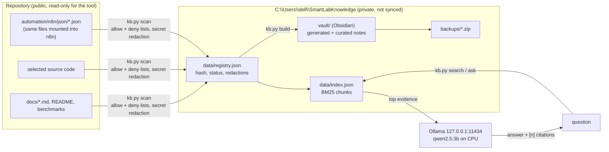

> Read-only mirror of `docs/knowledge-platform/README.md` - edit the original in the repository, not this note.

Systems: none

## Related
- [[docs_knowledge-platform_GRAPHIFY_ASSESSMENT.md]] - mentioned by docs

# Smart Lab knowledge platform

A local engineering knowledge base for the Smart Lab: an Obsidian-compatible Markdown vault,
a source registry, a catalogue of the n8n workflows, a local search index and optional answers
from the local LLM — all on this laptop. Built and measured 2026-10-13.

Other files here: [[docs_knowledge-platform_RESEARCH.md|RESEARCH.md]] (sources, options, decision) ·
[[docs_knowledge-platform_RUNBOOK.md|RUNBOOK.md]] (commands, backup/restore, activation) ·
[[docs_knowledge-platform_EVALUATION.md|EVALUATION.md]] (tests, measured quality and latency).

## What exists today (verified)

| Part | Where | State |
|---|---|---|
| Tool | `tools/knowledge/kb.py` (Python standard library only) | working, 16 tests |
| Vault | `C:\Users\dell\SmartLabKnowledge\vault` (outside the repo and outside OneDrive) | 156 source notes, 23 workflow notes, home, reports, templates |
| Private data | `C:\Users\dell\SmartLabKnowledge\data` (registry, index, workflow inventory, eval runs) | rebuilt by `kb.py build` |
| Backups | `C:\Users\dell\SmartLabKnowledge\backups` | zip + checksum manifest; restore verified (168 files) |
| Local LLM | Ollama 0.40.3, `qwen2.5:3b`, forced to the CPU | answers with citations, 24–68 s each |
| Obsidian app | not installed | the vault is plain Markdown; open it once installed |
| New n8n workflows | none created | Docker / n8n were not running; see RUNBOOK "Approvals" |

## How it fits together

Generated from the code in `tools/knowledge/kb.py` (update this diagram when that file changes).

## Locality (what leaves the laptop)

| Path | Evidence |
|---|---|
| Storage | vault, registry, index, backups: local folders above. `C:\Users\dell` is not under OneDrive (`$env:OneDrive` = `C:\Users\dell\OneDrive`). |
| Computation | parsing, indexing, search: local Python. Generation: local Ollama. |
| Network | only `http://127.0.0.1:11434` (Ollama). `kb.ask` refuses any non-localhost LLM URL (tested). No embedding API, no hosted vector DB, no telemetry. |
| Existing n8n workflows | all 23 definitions call only `http://backend:8000` (Docker-internal); none calls an external host (checked from the files 2026-10-13). Live state not checked (n8n was not running). |
| Obsidian app | not installed. Its own update checks and any community-plugin traffic are outside this tool; no plugin is required. |
| Installation traffic | none for this tool (no new packages). Ollama models were already downloaded. |

## Safety boundaries

* Read-only on the repository, database, n8n, Docker, devices. Writes only inside the vault's
  folders and the private data folder (`safe_write` refuses anything else — tested).
* Never read: `.env*`, `camera.env`, `robot.env`, `secrets.h`, keys/certs, dumps, images,
  video, models, datasets, recordings, private paper images, e2e scripts (full list in the
  vault's *Index status* note). Secret-looking values are redacted before indexing; a private
  list in `tools/knowledge/config.json` (git-ignored) removes known passwords too.
* Retrieved text is passed to the model as quoted DATA; the tool executes nothing from it.
* Nothing in the Smart Lab depends on this platform.

