# Database tables and relations

43 tables, read from `backend/app/models/` (commit 11003b0).

```mermaid
erDiagram
  users ||--o{ rfid_credentials : user_id
  users ||--o{ personal_qr_credentials : user_id
  users ||--o{ personal_qr_credentials : issued_by_id
  devices ||--o{ pc_account_keys : device_id
  labs ||--o{ devices : lab_id
  assets ||--o{ devices : asset_id
  labs ||--o{ lab_devices : lab_id
  devices ||--o{ lab_devices : device_id
  users ||--o{ bookings : user_id
  labs ||--o{ bookings : lab_id
  bookings ||--o{ booking_items : booking_id
  assets ||--o{ booking_items : asset_id
  inventory_bins ||--o{ booking_items : inventory_bin_id
  bookings ||--o{ qr_tokens : booking_id
  users ||--o{ qr_tokens : user_id
  labs ||--o{ qr_tokens : lab_id
  labs ||--o{ access_attempts : lab_id
  devices ||--o{ access_attempts : device_id
  users ||--o{ access_attempts : user_id
  bookings ||--o{ access_attempts : booking_id
  labs ||--o{ access_events : lab_id
  users ||--o{ access_events : user_id
  bookings ||--o{ access_events : booking_id
  devices ||--o{ access_events : device_id
  labs ||--o{ access_sessions : lab_id
  users ||--o{ access_sessions : user_id
  bookings ||--o{ access_sessions : booking_id
  devices ||--o{ access_sessions : device_id
  labs ||--o{ assets : lab_id
  users ||--o{ assets : holder_id
  assets ||--o{ asset_transactions : asset_id
  users ||--o{ asset_transactions : user_id
  labs ||--o{ asset_transactions : lab_id
  bookings ||--o{ asset_transactions : booking_id
  devices ||--o{ asset_transactions : device_id
  labs ||--o{ sensor_readings : lab_id
  devices ||--o{ sensor_readings : device_id
  labs ||--o{ alerts : lab_id
  devices ||--o{ alerts : device_id
  users ||--o{ alerts : acknowledged_by_id
  users ||--o{ alerts : owner_id
  users ||--o{ alerts : resolved_by_id
  alerts ||--o{ incident_notes : alert_id
  users ||--o{ incident_notes : user_id
  users ||--o{ audit_logs : actor_user_id
  users ||--o{ issues : reporter_id
  labs ||--o{ issues : lab_id
  assets ||--o{ issues : asset_id
  devices ||--o{ issues : device_id
  access_events ||--o{ issues : access_event_id
  users ||--o{ issues : assigned_to_id
  issues ||--o{ issue_photos : issue_id
  users ||--o{ issue_photos : uploaded_by_id
  issues ||--o{ issue_comments : issue_id
  users ||--o{ issue_comments : author_id
  issues ||--o{ issue_history : issue_id
  users ||--o{ issue_history : actor_id
  users ||--o{ notifications : user_id
  issues ||--o{ notifications : issue_id
  bookings ||--o{ notifications : booking_id
  devices ||--o{ device_commands : device_id
  users ||--o{ device_commands : target_user_id
  users ||--o{ device_commands : requested_by_id
  users ||--o{ face_submissions : user_id
  users ||--o{ face_submissions : reviewed_by_id
  labs ||--o{ inventory_bins : lab_id
  devices ||--o{ inventory_bins : device_id
  inventory_bins ||--o{ inventory_bin_items : bin_id
  inventory_bins ||--o{ inventory_measurements : bin_id
  inventory_bins ||--o{ inventory_transactions : bin_id
  users ||--o{ inventory_transactions : user_id
  bookings ||--o{ inventory_transactions : booking_id
  users ||--o{ inventory_transactions : recorded_by_id
  devices ||--o{ equipment_sessions : device_id
  assets ||--o{ equipment_sessions : asset_id
  labs ||--o{ equipment_sessions : lab_id
  users ||--o{ equipment_sessions : user_id
  bookings ||--o{ equipment_sessions : booking_id
  devices ||--o{ policy_violations : device_id
  labs ||--o{ policy_violations : lab_id
  devices ||--o{ security_zones : device_id
  assets ||--o{ security_zones : asset_id
  devices ||--o{ security_events : device_id
  labs ||--o{ security_events : lab_id
  security_zones ||--o{ security_events : zone_id
  users ||--o{ security_events : acknowledged_by_id
  labs ||--o{ lab_emergencies : lab_id
  users ||--o{ lab_emergencies : updated_by_id
  users ||--o{ experiments : operator_id
  devices ||--o{ experiments : device_id
  experiments ||--o{ experiment_trials : experiment_id
  users ||--o{ experiment_trials : recorded_by_id
  devices ||--o{ robot_events : device_id
  labs ||--o{ robot_events : lab_id
  bookings ||--o{ robot_events : booking_id
  devices ||--o{ robot_home_calibrations : device_id
  users ||--o{ robot_home_calibrations : created_by_id
  users ||--o{ workcell_setups : created_by_id
```

| Table | Class | Columns | Points to | What the code says |
|---|---|---|---|---|
| `access_attempts` | AccessAttempt (tables.py) | id, lab_id, device_id, user_id, booking_id, method, result, denial_reason, credential_ref, created_at | lab_id -> labs, device_id -> devices, user_id -> users, booking_id -> bookings | One row per credential presentation, successful or not. Separate from |
| `access_events` | AccessEvent (tables.py) | id, event_type, lab_id, user_id, booking_id, device_id, method, result, reason, message, event_metadata, created_at | lab_id -> labs, user_id -> users, booking_id -> bookings, device_id -> devices | The complete event timeline. Every lab-related event references a lab. |
| `access_sessions` | AccessSession (tables.py) | id, lab_id, user_id, booking_id, device_id, entry_method, second_factor, started_at, door_opened_at, door_closed_at, ended_at, end_reason | lab_id -> labs, user_id -> users, booking_id -> bookings, device_id -> devices | An occupancy span, opened when access is granted. |
| `alerts` | Alert (tables.py) | id, lab_id, device_id, severity, title, detail, is_resolved, created_at, resolved_at, dedupe_key, state, acknowledged_at, acknowledged_by_id, owner_id, resolved_by_id, resolution, fingerprint, occurrences, last_seen_at, reopened_count | lab_id -> labs, device_id -> devices, acknowledged_by_id -> users, owner_id -> users, resolved_by_id -> users |  |
| `asset_transactions` | AssetTransaction (tables.py) | id, asset_id, user_id, lab_id, action, created_at, note, booking_id, device_id, source, mass_delta_g, weight_check | asset_id -> assets, user_id -> users, lab_id -> labs, booking_id -> bookings, device_id -> devices |  |
| `assets` | Asset (tables.py) | id, asset_tag, name, category, lab_id, status, notes, created_at, serial_number, holder_id, checked_out_at, last_inspected_at, next_maintenance_at, nfc_uid, bin_item, unit_mass_g | lab_id -> labs, holder_id -> users |  |
| `audit_logs` | AuditLog (tables.py) | id, actor_user_id, action, entity_type, entity_id, detail, ip_address, created_at | actor_user_id -> users | Who did what, in the portal. Distinct from physical access events. |
| `booking_items` | BookingItem (tables.py) | id, booking_id, kind, asset_id, inventory_bin_id, quantity, label, created_at | booking_id -> bookings, asset_id -> assets, inventory_bin_id -> inventory_bins | Equipment a booking asks for, chosen while booking: a smart-bin item |
| `bookings` | Booking (tables.py) | id, user_id, lab_id, start_time, end_time, reason, status, created_at, cancelled_at, first_entry_at, last_entry_at, entry_count | user_id -> users, lab_id -> labs |  |
| `device_commands` | DeviceCommand (tables.py) | id, device_id, command, args, status, step, message, target_user_id, requested_by_id, created_at, expires_at, sent_at, completed_at | device_id -> devices, target_user_id -> users, requested_by_id -> users | A request from the portal for a door controller to do something, which |
| `devices` | Device (tables.py) | id, device_uid, name, device_type, lab_id, ip_address, firmware_version, last_seen_at, is_online, door_closed, component_state, key_hash, asset_id, mode, is_master_pc | lab_id -> labs, asset_id -> assets | Every physical device belongs to exactly one laboratory. |
| `equipment_sessions` | EquipmentSession (tables.py) | id, device_id, asset_id, lab_id, state, user_id, booking_id, detail, started_at, ended_at | device_id -> devices, asset_id -> assets, lab_id -> labs, user_id -> users, booking_id -> bookings | A period in one state (RUNNING / IDLE / FAULT) of a robot or PC, as its |
| `experiment_trials` | ExperimentTrial (tables.py) | id, experiment_id, repeat_number, input, expected, actual, measurement, unit, result, notes, recorded_by_id, recorded_at | experiment_id -> experiments, recorded_by_id -> users | One repeat of an experiment: input, expected, actual, measurement. |
| `experiments` | Experiment (tables.py) | id, code, name, subsystem, operator_id, device_id, firmware_version, hardware_configuration, configuration, environment, network_state, data_mode, test_condition, expected_result, actual_result, result, notes, status, started_at, ended_at, created_at | operator_id -> users, device_id -> devices | One controlled experiment (a protocol run on real hardware). While it is |
| `face_submissions` | FaceSubmission (tables.py) | id, user_id, status, photo_keys, thumb_keys, photo_count, created_at, reviewed_by_id, reviewed_at, reason, samples_saved | user_id -> users, reviewed_by_id -> users | Face photos a person sends from the portal to be enrolled for the door. |
| `incident_notes` | IncidentNote (tables.py) | id, alert_id, user_id, kind, text, created_at | alert_id -> alerts, user_id -> users | Activity on an incident: notes, state changes, recovery actions, AI hypotheses (labelled). |
| `integration_events` | IntegrationEvent (tables.py) | id, event_id, event_type, occurred_at, lab_id, user_id, device_id, object_type, object_id, correlation_id, payload, delivery_status, attempts, next_attempt_at, delivered_at, last_error |  | Transactional outbox for external automation (n8n). |
| `inventory_bin_items` | InventoryBinItem (tables.py) | id, bin_id, item_name, category, tare_g, unit_mass_g, noise_g, reorder_qty, stock_max, calibrated_at, is_selected, is_active, created_at | bin_id -> inventory_bins | One scale, several items (2026-11-20): a saved calibration per kind of part a bin can hold. The bin row |
| `inventory_bins` | InventoryBin (tables.py) | id, code, lab_id, device_id, item_name, category, tare_g, unit_mass_g, noise_g, calibrated_at, min_change_g, reorder_qty, stock_max, last_mass_g, last_measured_at, notes, is_active, created_at | lab_id -> labs, device_id -> devices | One weighing bin of a bulk consumable (e.g. 10 kOhm resistors). Mass is |
| `inventory_measurements` | InventoryMeasurement (tables.py) | id, bin_id, mass_g, recorded_at | bin_id -> inventory_bins | A stable reading reported by a bin node (raw history for analysis). |
| `inventory_transactions` | InventoryTransaction (tables.py) | id, bin_id, kind, delta_mass_g, delta_qty_est, qty_est_after, actual_count, user_id, booking_id, attribution, recorded_by_id, note, recorded_at | bin_id -> inventory_bins, user_id -> users, booking_id -> bookings, recorded_by_id -> users | A stock change. WITHDRAWAL / REFILL come from stable mass steps; COUNT is |
| `issue_comments` | IssueComment (tables.py) | id, issue_id, author_id, body, is_internal, created_at | issue_id -> issues, author_id -> users |  |
| `issue_history` | IssueHistory (tables.py) | id, issue_id, actor_id, event_type, old_status, new_status, message, detail, is_internal, created_at | issue_id -> issues, actor_id -> users | The issue's audit trail and timeline in one: every change is a row with |
| `issue_photos` | IssuePhoto (tables.py) | id, issue_id, uploaded_by_id, stage, storage_key, thumb_key, original_filename, content_type, size_bytes, width, height, created_at | issue_id -> issues, uploaded_by_id -> users | Metadata only. The image bytes live in object storage (the local |
| `issues` | Issue (tables.py) | id, ticket_number, reporter_id, lab_id, asset_id, device_id, access_event_id, category, severity, status, title, description, additional_comments, assigned_to_id, resolution_notes, created_at, updated_at, acknowledged_at, resolved_at, closed_at | reporter_id -> users, lab_id -> labs, asset_id -> assets, device_id -> devices, access_event_id -> access_events, assigned_to_id -> users | A problem reported in a laboratory - broken equipment, a missing tool, a |
| `lab_devices` | LabDevice (tables.py) | id, lab_id, device_id, role | lab_id -> labs, device_id -> devices | Association table. Device.lab_id is the owning lab; this allows a device |
| `lab_emergencies` | LabEmergency (tables.py) | lab_id, door_mode, door_until, message, message_until, alarm, speak, version, updated_by_id, updated_at | lab_id -> labs, updated_by_id -> users | A lab's emergency state, set by an administrator from the Emergency tab. |
| `labs` | Lab (tables.py) | id, code, name, description, location, capacity, category, has_controller, exclusive_booking, require_booking_for_rfid, is_active, created_at |  |  |
| `notifications` | Notification (tables.py) | id, user_id, kind, severity, title, body, link, issue_id, booking_id, is_read, created_at, read_at, dedupe_key, source | user_id -> users, issue_id -> issues, booking_id -> bookings | A message for one person, raised by something that actually happened - |
| `pc_account_keys` | PcAccountKey (tables.py) | id, device_id, account, key_hash, created_at | device_id -> devices | A lab PC's key for one Windows account (2026-11-07): each account keeps its own, so accounts on one PC do not |
| `personal_qr_credentials` | PersonalQrCredential (tables.py) | id, user_id, token_sha256, issued_at, issued_by_id, revoked_at | user_id -> users, issued_by_id -> users | A person's door QR (e.g. in their phone's Wallet): a card that lives in a |
| `policy_violations` | PolicyViolation (tables.py) | id, device_id, lab_id, kind, detail, os_user, reviewed, created_at | device_id -> devices, lab_id -> labs | An exam-mode policy breach a PC agent reported (e.g. a prohibited |
| `qr_tokens` | QrToken (tables.py) | id, token, booking_id, user_id, lab_id, valid_from, valid_until, issued_at, revoked_at, last_used_at, use_count | booking_id -> bookings, user_id -> users, lab_id -> labs | A booking's door credential. |
| `rfid_credentials` | RfidCredential (tables.py) | id, uid_hex, label, user_id, is_active, issued_at, revoked_at | user_id -> users | The physical card/tag. Stores the UID only - a card UID (read by the PN532) is not secret |
| `robot_events` | RobotEvent (tables.py) | id, device_id, lab_id, kind, joint, detail, source, occurred_at, received_at, booking_id, context, severity | device_id -> devices, lab_id -> labs, booking_id -> bookings | A robot motion / telemetry transition reported by its collector: |
| `robot_home_calibrations` | RobotHomeCalibration (tables.py) | id, device_id, version, home_q, home_tcp, tolerance_deg, note, created_by_id, created_at | device_id -> devices, created_by_id -> users | A robot's HOME pose, taken from live telemetry by an administrator. |
| `roles` | RoleRow (tables.py) | id, name, description |  | Roles as data as well as an enum on users. The enum enforces the value at |
| `security_events` | SecurityEvent (tables.py) | id, device_id, lab_id, zone_id, kind, detail, people_seen, people_inside, snapshot_key, created_at, acknowledged_at, acknowledged_by_id | device_id -> devices, lab_id -> labs, zone_id -> security_zones, acknowledged_by_id -> users | Something the security camera saw that staff should look at: a person |
| `security_zones` | SecurityZone (tables.py) | id, device_id, name, kind, asset_id, x, y, w, h, alert_on_motion, ref_version, created_at | device_id -> devices, asset_id -> assets | A box drawn on the security camera's view: a fixed item (PC, robot...) |
| `sensor_readings` | SensorReading (tables.py) | id, lab_id, device_id, metric, value, unit, recorded_at | lab_id -> labs, device_id -> devices | Structure only. Nothing writes here until a real sensor node exists; the |
| `system_settings` | SystemSetting (tables.py) | key, value, updated_at |  | Small key/value settings changed from the portal (e.g. the emergency |
| `users` | User (tables.py) | id, email, username, full_name, hashed_password, role, is_active, auth_subject, student_id, department, created_at, fingerprint_enrolled_at, face_enrolled_at |  |  |
| `workcell_setups` | WorkcellSetup (tables.py) | id, robot_key, name, data, created_by_id, created_at | created_by_id -> users | A robot's VIRTUAL workcell (table + obstacles) drawn in the digital twin - manual or |
