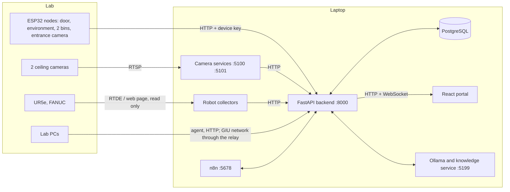

# Lesson 1: the Smart Lab as one integrated system

**After this lesson you can** explain the whole project in two to three minutes, name who decides what, and follow one temperature value from the sensor to the screen.

## 1. Simple explanation
The lab has senses (sensors, cameras, card reader), muscles (the door lock, a servo), machines it only watches (two robots, PCs), one memory (the database), one place where rules are checked (the backend) and one face (the portal). Each part does one job, and each part says honestly when it does not know.

## 2. The map

There is no MQTT. OPC UA is a read-only server that publishes the lab's values (`tools/opcua`); the robots are not read through it. The FANUC is read from its own web page, the UR5e over RTDE.

## 3. Who decides what
| Question | Decided by | Never by |
|---|---|---|
| Does the door open? | Master ESP32, after two matching factors | portal, camera, assistant |
| Is this card or QR valid now? | backend | the card itself |
| Who is this person on camera? | door, face or staff (confirmed); looks and seats only guess | clothes, desk |
| Does a robot move? | people at its pendant | anything in this project |
| Is a value current? | its time stamp | the last number on the screen |

## 4. One value, step by step: temperature
| Step | Where | What happens |
|---|---|---|
| 1 | DHT22 on GPIO 4 (`PIN_DHT`) | one-wire digital signal |
| 2 | `firmware/SmartLab_Environment_Node/env_sensors.h` | read about every 2.5 s; a failed read is counted, an old value becomes not valid (`dhtValid`) |
| 3 | `env_network.h` `postJson` | `POST /api/access/telemetry` with header `X-Device-Key` |
| 4 | `backend/app/api/routes/access.py` `telemetry()` | `TelemetryRequest` checks the shape: metric name, finite number, at most 20 readings |
| 5 | same function | `require_device`, `device_scope`, `device_lab_scope`: this key, this device, this lab only |
| 6 | `SensorReading` row | value, unit and the **server's** UTC time; nothing is interpolated |
| 7 | `services/environment.py` | `record_hazards` and `record_advisories` raise or clear alerts; quality marks such as OUT_OF_RANGE and STALE |
| 8 | after the commit | `environment.publish({"type": "env_update"})` over the WebSocket |
| 9 | portal | open pages fetch the new value; Sensors shows the history |
If Wi-Fi drops, no row appears and the portal shows the value as old. It does not repeat the last one.

**Why commit first, publish second?** A page that refetches on the message must find the row.
**Why the server's time?** The lab PCs' clocks were 70.8 s off on 24 Nov; one clock makes rows comparable.

## 5. Ten concepts to own
Two-factor access that fails closed · time stamps and staleness · confirmed against guess · detection, tracking, re-identification · homography (floor map) · read-only robot telemetry · WebSocket events · roles checked on the server · retrieval before generation · median against p95.

## 6. Common mistakes
- "The portal opens the door." It cannot; no address reaches the relay.
- "The cameras know everyone." They confirm by face, door or staff only, and no accuracy was measured.
- "The twin moves, so the robot is connected." A twin can replay old data; look at the age.
- "14 pictures a second and 6 analyses a second contradict." One is capture, one is analysis.

## 7. Your turn
**Questions** (answer here in the chat, in your own words):
1. The laptop crashes while somebody presents a valid card. What happens at the door, and why is that the right design?
2. Why does `telemetry()` use the server's clock, and what would go wrong otherwise?
3. The twin shows the UR5e standing still. Name two different situations that look like this and how the system tells them apart.
4. A man sits at PC-08 where a staff-confirmed person sat a minute ago. What may camera 1 show, and what may it never show?
5. Camera capture is 14.7 per second, analysis 6.0, the median pass 123 ms. Why can all three be true?

**Exercise:** draw the map from memory, then follow "a student books a lab and enters" through it. Write for each arrow who checks what.

**Without notes you should be able to say:** the purpose in one sentence, the five kinds of parts, the table in section 3, and the nine steps in section 4.
